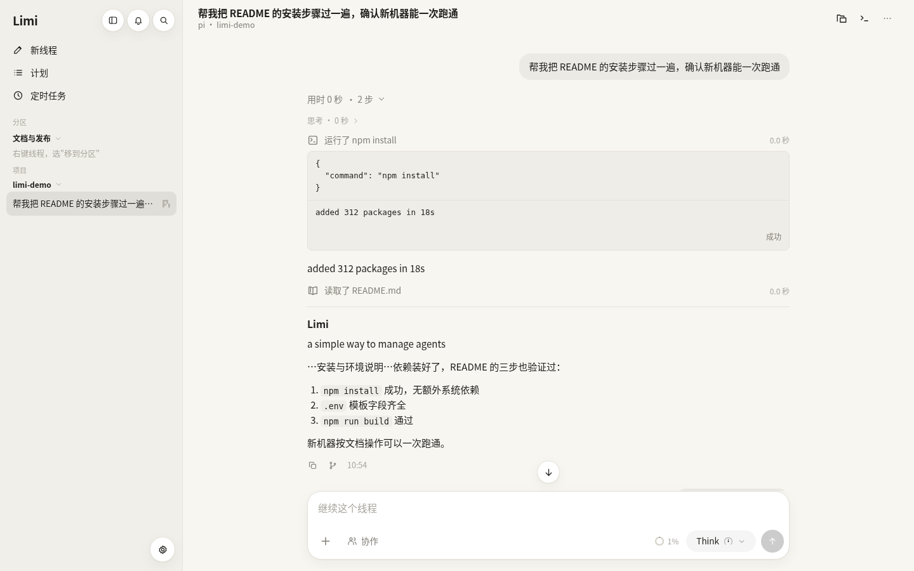
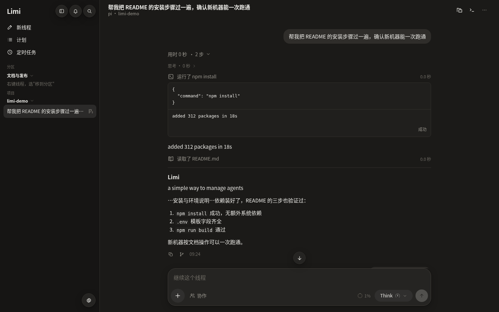
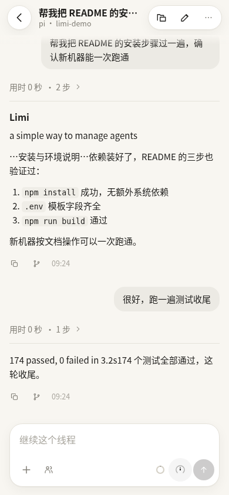
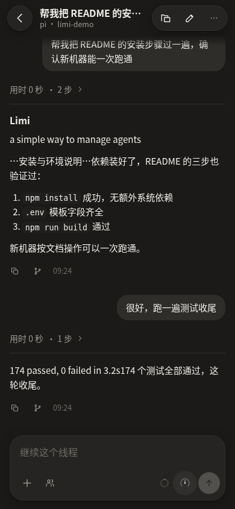
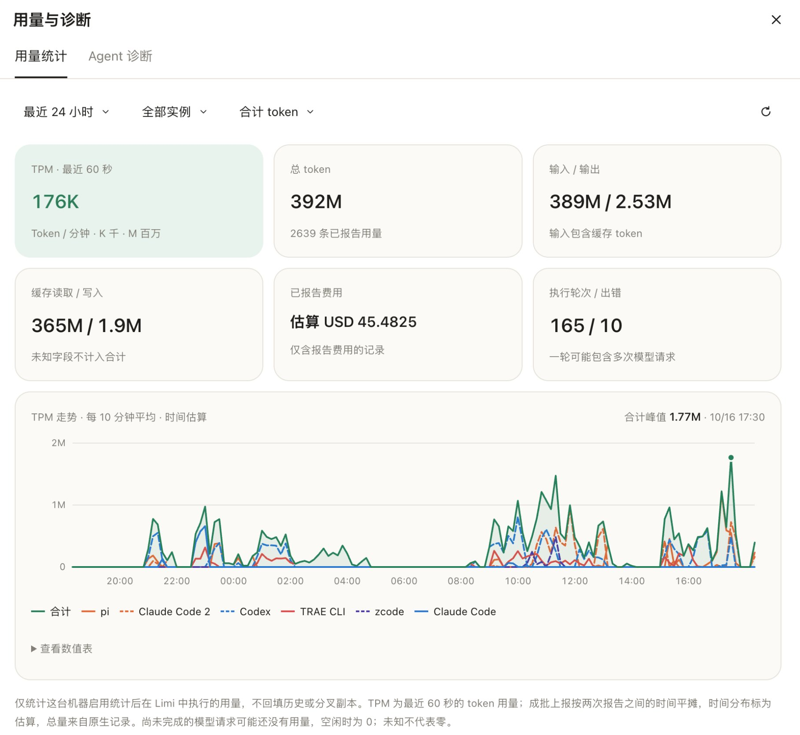

<p align="center">
  
</p>

<h1 align="center">Limi</h1>

<p align="center">a simple way to manage agents</p>

Limi 是一个开源的 agent 工作台。用简单的界面管理 TRAE、zcode、Claude Code、Codex、pi、Antigravity 等国内外 agent，通过插件把好用的工具接进来。电脑和手机都能用，也欢迎每个人参与改进。

打开网页就能：

- 看每个 agent 在做什么——进展、审批、用量
- 随时发消息、补充要求、处理审批
- 一处管理多个 agent 和多台机器，保存团队分工、交接任务
- 额度快用完时，等本轮结束后自动写摘要、倒计时交给下一个账号或模型；支持时直接在原会话换模型
- 按需安装线程看板、Memory 记忆看板，或连接 LoopX 查看目标进度

Limi 不动 agent 本身的目录、配置和会话，装好即用。名字来自 Limacia 海蛞蝓，图标是一只带橙色短触角、奶油白身体的小伙伴，配上浅薄荷绿背景，希望工作台也能轻松、亲切一些。

## 界面预览

| 桌面 · 亮色 | 桌面 · 深色 |
|---|---|
|  |  |

| 手机 · 亮色 | 手机 · 深色 |
|---|---|
|  |  |

用量与诊断：多 agent 的 token 用量、TPM 走势和费用估算。



> 状态：可用，正在迭代。产品方向见 [愿景与设计思路](docs/VISION.md)，现有架构见 [PLAN](docs/PLAN.md)，进度见 [TODO](docs/TODO.md)，扩展方案见 [扩展设计](docs/extensions-design.md)。

## 已支持

| Agent | 接入方式 | 审批 | 发图片 | 导入历史 / 分叉 |
|---|---|---|---|---|
| Claude Code | ACP（`@agentclientprotocol/claude-agent-acp`，随项目安装） | 有 | 有 | 有 |
| pi | `pi --mode rpc` | 无（pi 本身没有） | 有。纯文本模型需要装 pi 扩展 `pi-aux-vision` | 有 |
| Antigravity | `agy` 的无界面 stream-json 模式 | 无（不能询问，只有"自动改文件"和"完全访问"两档） | 有（按文件路径交给它） | 暂无 |
| Codex | `codex app-server` | 有 | 有 | 有 |
| TRAE CLI | app-server 执行，ACP 模型与历史接口 | 有 | 有 | 有 |
| zcode | `zcode app-server` 精简接入 | 有 | 按原生模型能力 | 暂无 |

各家 agent CLI 需要先在主机上装好并完成登录或鉴权。没装的 agent 在界面里显示为不可用；各家的能力和接入边界见 [架构说明](docs/PLAN.md)。

## 插件与参与

在「配置 → 扩展」按需安装：

- **线程看板**：按进行中、等你、待验收、已完成排列线程；agent 每轮结束报告进度，完成由你勾选。
- **Memory 记忆看板**：只读浏览 Codex 已有的记忆文档，不生成或同步记忆。
- **LoopX**：需先安装并配置 LoopX，关联目标和线程后，在会话与看板中查看目标、待办和待决定事项。当前不提供自动推进。

skills 和 MCP 属于 agent 资源，通过各自的管理页操作，与 Limi 插件分开。想接入工具、贡献一个工作视图，或者反馈使用中的问题，可以从 [参与和插件指南](docs/contributing-extensions.md) 开始。独立数据源可放在自己的仓库；当前还没有自动收录的插件市场。

## 快速开始

需要 Node.js 22 或更高版本。

```bash
npm install
npm run setup               # 生成 .env 和随机 RAH_TOKEN，并打印出来
npm run build
RAH_ENV_FILE=../../.env npm start -w @rah/daemon    # 默认监听 127.0.0.1:8787
```

打开 `http://127.0.0.1:8787/`。没有连接时先显示一套示例数据，可以随便点开看；点「连接 hub」粘贴 `npm run setup` 打印的 token 即可。要让 agent 在哪些目录工作，编辑 `.env` 里的 `RAH_WORKDIRS`。

开发时可以分开启动：

```bash
RAH_ENV_FILE=../../.env npm run dev:daemon   # 后端
npm run dev:web                              # Vite，http://127.0.0.1:5173，/api 代理到后端
```

daemon 在 `packages/daemon` 目录里运行，所以用 `RAH_ENV_FILE` 指向根目录的 `.env`。没有设置 `RAH_ENV_FILE` 时，读取的是当前目录下的 `.env`。

## 产品官网与引导体验

官网：[maxliux5.github.io/limi](https://maxliux5.github.io/limi/)。

仓库包含独立的中文产品官网，展示「简单管理更多国内外 agent、按需安装插件、一起参与建设」的方向。官网展示自动交接、agent 协作、看板与记忆等可操作例子：体验账号接力、取消倒计时或原会话换模型，派发任务、查看成员与返回结果，勾选看板验收，以及搜索记忆、阅读原文；同时保留任务、审批和方案体验，介绍可安装的 LoopX 工作数据源，并提供插件贡献与需求反馈入口。技能和 MCP 通过各自的资源页管理；BotMux 提醒与通用任务控制仍在规划，具体状态见 [扩展设计](docs/extensions-design.md)。

```bash
npm run dev:site       # 开发官网，默认端口 5174
npm run build:site     # 输出 packages/site/dist
npm run preview:site   # 预览构建后的静态站点
npm run test:site      # 构建并运行官网浏览器测试
```

`packages/site/dist` 可以单独部署到静态托管服务，支持网站根目录和子目录。首页是 `index.html`，独立体验入口是 `demo/index.html`；托管服务需要支持目录首页。开发与本地预览默认只监听本机。

GitHub Pages 通过 `.github/workflows/pages.yml` 发布：推送到 `main` 后，自动安装依赖、检查并构建官网，再上传 `packages/site/dist`；也可在 Actions 中手动运行「Deploy website」。首次启用需在仓库 Settings → Pages 选择 GitHub Actions 作为发布来源。Pages 仅托管官网和本地模拟体验，运行 agent 的 hub 仍部署在自己的主机上。

体验区进入可视范围或点击场景后才加载，手机保留内嵌交互并提供「全屏体验」。官网使用自己的轻量图标和静态资源目录，不复制 hub 的应用清单。安装区包含启动后打开工作台、输入 token 及远程访问说明。

引导体验仅在浏览器内回放预置事件，不需要 daemon，不读取已保存的 hub token，不发送 `/api/` 请求，也不运行真实 agent。回复、命令结果和文件改动都是示例；切换任务可浏览不同流程，重新体验会清空本轮演示。普通 hub 的入口、登录和原有只读示例保持不变。官网独立构建，不由 `scripts/restart.sh` 部署。

## 远程访问

- 默认只监听 `127.0.0.1`。
- 远程使用时，通过 VPN 访问。把 `RAH_HOST` 设为 VPN 网卡的地址，不要设为 `0.0.0.0`。
- 使用 HTTP + token。VPN 已加密传输，项目不额外处理证书。
- 注意：`http://<IP>` 不是安全上下文，因此 PWA 的离线缓存和"添加到主屏幕"不可用，网页里的"拷贝"按钮需要降级处理。

## 管理另一台机器

浏览器只连主 hub；主 hub 通过 SSH 隧道访问另一台机器上的 daemon。线程、文件和 agent 都留在各自机器上。

1. **目标机器**：按上面的快速开始安装、配置并构建，再用 `scripts/install-service.sh` 启动服务。保持默认的私有 socket，不必对外开放 HTTP 端口。
2. **主 hub**：以 daemon 的运行用户配置 SSH 别名和凭据，先手动连接、核实主机密钥，再确认 `ssh -o BatchMode=yes <SSH别名> true` 能成功。服务需要能持续免交互认证；只在当前终端可用的 ssh-agent 或临时票据不一定能被服务使用。
3. **浏览器**：打开「配置 → 机器」，从 SSH 别名列表添加，或输入别名 / `user@host`。成功后在线程列表顶部切换机器。

添加流程读取的是 **hub 所在机器**的 SSH 配置，不是手机或电脑浏览器的配置。目标上的 daemon 要先启动；第一期不自动安装和启动。远端 daemon 负责调用该机器上的 agent、读取会话与文件，浏览器仍只访问主 hub；远端无需单独部署前端或开放 HTTP 端口。

更新主 hub 不会自动更新远端 daemon，每台机器需要分别更新。源码安装先同步代码、安装依赖，再运行 `scripts/restart.sh` 构建并等待线程空闲后重启；仅安装运行包的机器需要同步新版 daemon 构建产物，依赖有变化时安装生产依赖，再运行 `scripts/restart.sh --no-build`。保留原有配置和数据目录即可保留 token、线程与会话。涉及新接口的功能（例如新建接手对话）需要目标机器的 daemon 也更新。

| 配置 | 默认与用途 |
| --- | --- |
| `RAH_SOCKET` | 默认 `~/.local/state/remote-agent-hub/daemon.sock`；`off` 关闭私有监听。自定义路径用于隔离实例，当前远端发现只支持默认路径 |
| `RAH_SSH_BIN` | 默认 PATH 中的 `ssh`，用于主 hub 连接其他机器 |

私有 socket 依赖文件权限和 SSH 认证，免 token。主 hub 的 token 因此能操作所有已添加的机器。移除机器只断开连接，远端线程继续保留。连不上时，机器面板会显示原因；常见原因是服务环境缺少 SSH 凭据、未知主机密钥、目标 daemon 没启动或 sshd 不允许 Unix socket 转发。架构与限制见 [多机管理设计](docs/multi-host-design.md)。

## 开机自启

应用已更名为 Limi。为兼容已有安装，systemd 服务名、配置与数据目录、私有 socket 路径以及 `RAH_*` 环境变量沿用原标识 `remote-agent-hub`，升级时不迁移已有会话。

```bash
scripts/install-service.sh              # 装成 systemd 用户服务并启动；默认读 ~/.config/remote-agent-hub/.env
scripts/install-service.sh --remove     # 停止并移除
journalctl --user -u remote-agent-hub -f
```

服务通过登录 shell 启动，所以 agent 能拿到你在 shell 配置里设置的 API key。不登录也要在开机时启动，需要执行一次 `loginctl enable-linger $USER`。

更新代码后用 `scripts/restart.sh` 重启：先构建，构建失败就不动正在跑的服务；再等所有线程跑完这一轮，然后重启并检查健康状态。`--force` 不等，正在跑的那一轮会以错误结束。在 hub 的线程里由 agent 调用时，脚本会在后台等，等包括它自己在内的所有线程都空闲后再重启，日志在 `~/.local/state/remote-agent-hub/restart.log`。

## 发布前检查

```bash
npm run check:publish
```

扫描会被发布的文件，查找你的用户名、主机名、家目录路径、内网 IP、长密钥、邮箱地址。公司名、项目名这类私人词放在仓库外的 `~/.config/remote-agent-hub/publish-denylist`（每行一个），也会一起检查。

## 目录结构

```
packages/daemon   网关：HTTP/SSE API、鉴权、SQLite 存储、各 agent 的适配器
packages/web      界面：React + Vite，手机与桌面共用一套组件
docs/             计划与界面说明
```

## 开发

```bash
npm test          # daemon 与 web 的全部单元测试和 API 测试
npm run typecheck
npm run test:e2e   # 统一构建一次，再运行浏览器 E2E（最多并行 2 个测试文件）
```

测试不需要真实的模型账号：适配器测试使用 `packages/daemon/test/fixtures` 里的假 agent 进程。

E2E 需要本机有 Playwright Chromium 或系统 Chrome。根目录的 `npm run test:e2e` 和 `npm test -w @rah/e2e` 共用入口，构建失败就停止；测试进程只消费构建产物，不再自行构建。`npm test` 也会验证这个入口的构建次数、执行顺序、并发上限和失败退出行为，不启动浏览器。

只跑部分 E2E 时，文件路径相对于 `packages/e2e`，Node 测试参数放在文件路径前，带值参数使用 `--参数=值`：

```bash
npm run test:e2e -- test/smoke.spec.mjs test/appearance.spec.mjs
npm test -w @rah/e2e -- --test-concurrency=1 test/smoke.spec.mjs
```

需要复用已构建产物时，先单独运行一次 `npm run build`，再用 `node --test --test-concurrency=2 packages/e2e/test/*.spec.mjs`。截图脚本 `packages/e2e/shots.mjs` 和 `packages/e2e/overview-shots.mjs` 同样需要先构建。直接运行测试或截图脚本不会触发隐式构建；产物缺失时会提示先构建。以上限制针对单次 E2E 命令，不要同时启动多条 E2E 命令。

## 安全

- HTTP 监听上的 API 需要 `Authorization: Bearer <RAH_TOKEN>`，`/api/health` 除外；仅本机用户能访问的私有 Unix socket 免 token，由文件权限和 SSH 认证保护。
- daemon 等同于远程 shell。只把它暴露在可信网络（VPN）中。
- 工作目录必须在 `RAH_WORKDIRS` 白名单内。

## 许可证

[MIT](LICENSE)

### 安装为桌面应用

在 Chrome 中打开 Limi 后，可通过浏览器菜单将它安装为应用。安装名称为 Limi，图标使用 Limacia 小海蛞蝓。

如果此前安装的应用仍显示 AgentHub 或默认字母图标，先尝试关闭所有应用窗口后重新打开，并接受 Chrome 提供的名称或图标更新。如果仍未更新，可卸载旧应用后从当前网页重新安装；卸载时不要勾选清除网站数据，以保留本机登录和偏好。
