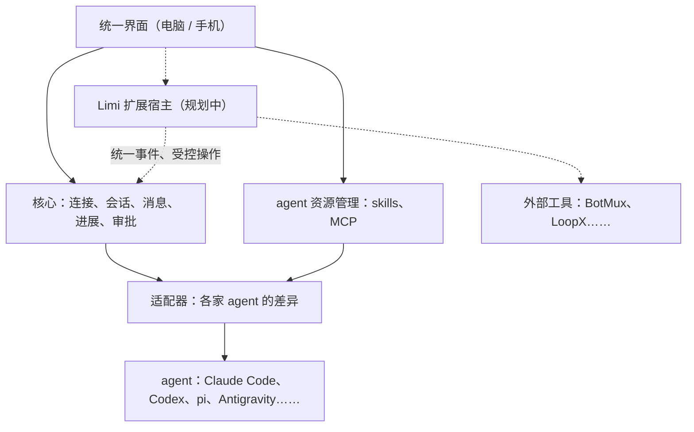

# Limi 的愿景与设计思路

**用一个像 Codex 一样简洁的界面，管理跨机器的 agent、它们自己的资源，以及周边的工具。**

现状：管理 agent 的核心功能，以及 skills 和 MCP 的统一管理已经可用；统一的扩展入口、扩展宿主，以及 BotMux、LoopX 的接入都还没有实现。

## 为什么有人会用 Limi

- **很快把多个 agent 都用起来。** 主机上已经装好的 Claude Code、Codex、pi、Antigravity 等，在同一个界面里就能用，不改它们的配置和会话。多台机器、电脑和手机都能接手；一个 agent 额度用完，可以交给另一个接着做。
- **界面简洁，而且好看。** 标准是 Codex，目标是超过它。
- **容易扩展。** 兼容的 agent 资源在一处管理；周边工具可以用简单的方式接进界面。具体接入机制仍在设计中。

## 三条路径

| 路径 | 管什么 | 状态 |
| --- | --- | --- |
| 管理 agent | 连接、会话、发消息、看进展、处理审批，以及计划、定时任务、协作、交接 | 已有 |
| 统一管理 agent 资源 | 各家 agent 自己的东西：skills、MCP 配置、原生插件等可安装资源；记忆这类 agent 生成的状态；`AGENTS.md`、`CLAUDE.md` 这类指令文件 | skills 和 MCP 已有，其余待调研 |
| 用 Limi 扩展接入外围工具 | 在 agent 外面运行的工具，例如 BotMux 提醒、LoopX 长程推进 | 设计中 |

**agent 资源**按各家 agent 自己的机制生效，Limi 负责跨机器、跨 agent 地查看，可安装的资源只装到兼容的实例。三类资源能做的操作不一样，不是每一类都能安装或删除。

**Limi 扩展**把外围工具接进 Limi 的界面：一个统一的入口、远程和手机上的访问，以及和线程的关联。

## 怎样低成本地接进来

- **已有的 skills 和 MCP**：走现有的资源管理和适配器，装到兼容的 agent 上。安装资源不需要写扩展，也不需要运行时 hook。
- **新的外围工具**：优先写一份清单，声明检测方式、状态命令和操作；需要自己逻辑的，再做成独立进程。界面统一由 Limi 绘制。

这两条路分开走。不存在「一个包装上就能给所有 agent 用」：资源要看每家 agent 兼容不兼容，扩展接的是 Limi 的界面，不是 agent。

## 整体架构

实线是已有的部分，虚线是规划中的部分。Limi 扩展只经过核心提供的统一事件和受控操作工作，不绕过适配器直接操作 agent。

## 原则

- **基本流程完整，外围能力按需接入。** 不装任何扩展，也能连接、发任务、看进展、处理审批。现有的其他核心功能仍在核心里，并没有迁成扩展。
- **原生优先，差异如实。** agent 自己有的能力（例如原生 `/goal`）就用它自己的；各家能力不一样时，界面如实显示，不伪造 agent 没有的能力。
- **不增加界面负担。** 没启用的扩展不出现在界面上；启用后只在相关的位置按需显示。
- **Limi 本身不进 agent 的工具循环。** 不给模型加工具，不往 agent 里注入 prompt；用户选择的原生资源仍按 agent 自己的机制生效。审批由人来做。
- **不做编辑器，也不做文件写入器。** 文件只读；终端是给人用的运维工具。
- **遵守 `AGENTS.md` 的现有边界。** 不改 agent 的目录、配置和会话。新的配置写入入口（例如安装更多类型的资源）需要单独决定，愿景不放宽这条边界。

## 相关文档

- [PLAN.md](PLAN.md)：各模块怎么实现。
- [TODO.md](TODO.md)：要做的事。
- [扩展设计](extensions-design.md)：Limi 扩展机制的设计稿。
