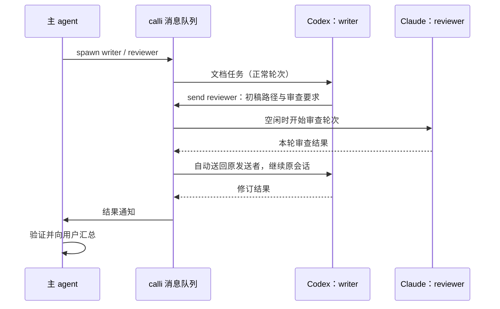

# calli Agent 协作设计

状态：第一版已实现，等待真实 agent 沙箱联调；不代表已部署。更新：2026-10-12。

## 核心决定

采用「普通主线程 + 独立成员线程 + 持久消息队列」。主 agent 拆任务、选择实例与目录、验收结果；calli 负责启动线程、传消息、保存状态和展示输出。复用现有适配器、线程执行、审批、事件日志与 SSE，不引入第二套 agent 执行循环。

这是相对简单的方案。必要的复杂度集中在消息投递：忙时排队、请求去重、停止和重启恢复。主控在本机 daemon，成员可以在本机，也可以在主 hub 已登记的其他机器上（见下文「其他机器上的成员」）。最多 3 个成员同时运行、12 个成员、30 条待处理消息；成员只能联系现有成员，不能继续招募。每个成员绑定一个 cwd，多个目录用多个成员表达。

## 开源项目的做法

| 项目与来源 | 已核对的做法 | 本项目取舍 |
|---|---|---|
| [agent-deck Conductor](https://github.com/asheshgoplani/agent-deck/blob/main/docs/conductor/README.md)、[CLI](https://github.com/asheshgoplani/agent-deck/blob/main/skills/agent-deck/references/cli-reference.md) | 主控是普通持久会话；CLI 指定目录创建子会话、发送消息和读取输出；完成通知落盘，主控在轮次边界或心跳时取回 | 借鉴普通会话、CLI、父子关系、持久通知；使用 Hub 已有结构化事件，不引入 tmux、心跳推理和它的配置目录管理 |
| [OpenCode Agents](https://opencode.ai/docs/agents/) | primary 调用 subagent，子会话可进入查看并返回父会话 | 借鉴主对话内展示子任务、保留独立上下文 |
| [Goose Subagents](https://github.com/aaif-goose/goose/blob/main/documentation/docs/guides/context-engineering/subagents.mdx) | 委派任务可串行或并行，展示子 agent 工具活动并返回结果 | 借鉴任务委派和结果摘要，不引入 recipe 系统 |
| [Claude Squad](https://github.com/smtg-ai/claude-squad#how-it-works) | tmux 管理多个终端会话，git worktree 隔离工作副本 | 借鉴 worktree 作为可选隔离方式；它的会话管理本身不足以完成主 agent 自动指挥的闭环 |

目录不能只写在提示词里。OpenCode 的[跨目录子会话讨论](https://github.com/anomalyco/opencode/issues/36605)明确涉及 cwd、本地指令加载和跨目录结果回传。该 issue 是需求与插件实践记录，不能据此认定其主线已经支持。我们的子线程应通过现有 `adapter.start({ cwd })` 在目标目录启动，由 agent 自己加载项目指令。

## Claude Team 的启发

[Claude Code Agent Teams 官方文档](https://code.claude.com/docs/en/agent-teams)描述了主控、独立 teammate、共享任务列表和 mailbox。成员有自己的上下文，可以直接联系其他成员，结果自动通知主控。它提供了通信与任务协调的参考；此处不把 Claude 的产品内部实现视作可直接复用的开源协议。

calli 借鉴独立会话和邮箱，先不做共享任务依赖图。消息保存在自己的 SQLite 中，经各适配器启动正常轮次，因而可以跨 Codex、Claude 等实例。不会读写 Claude Team 的内部邮箱或修改 agent 原生会话文件。

## 用户入口

1. 在输入框工具栏点「协作」，选择允许使用的已有目录，再点「启用协作」。已有线程要等当前轮结束；新线程可以在发送第一条消息前启用。
2. 输入 `@`，选择可用实例或已有成员。选实例表示请主控创建成员；选成员表示继续原线程。新成员的标签可选择目录，默认继承主线程。当前启用时默认允许所有可用且支持协作环境的实例，API 也支持显式限制实例集合。
3. 用自然语言说明分工，例如「让 Codex 写设计文档，让 Claude 审查，修改完成后你再验收」。`@` 被作为结构化对象校验并随任务提供给主 agent，不会仅凭选中标签就启动工作。
4. 宽屏时对话右侧留白处出现智能体卡片，放不下时顶栏右侧出现智能体标记。打开后先看成员列表，点击成员查看实时输出、工具调用和审批。

默认在原目录工作，不自动创建 worktree。相同文件的修改由主控串行安排；审查时暂停对被审查文件的写入。文件分工是约定，不是文件锁。可以选用已有 worktree 目录，合并、分支操作和最终验证仍由主控安排。

## 命令怎么给 agent

不要求用户安装 Skill。启用协作后，适配器在启动或恢复进程时传入运行期环境：CLI 所在 PATH、专用 Unix socket 地址和线程范围凭据。已存在的空闲进程会先关闭，再按原生会话 ID 恢复，以加载环境；不更改项目目录、账号配置或原生历史文件。

每个正常轮次会附加一小段协作说明，告诉 agent 自己是主控还是成员、允许目录、命令与通信规则。它属于本轮输入，界面隐藏这段运行说明。凭据只在进程环境内，不写进提示词或协作数据库。Skill 可在以后承载复杂分工经验，不作为功能可用的前提。

命令使用 JSON 返回结果；错误通过非零退出码和错误文本返回。当前没有单独的稳定机器错误码体系。

| 命令 | 用途 |
|---|---|
| `calli agents` | 本次协作允许的实例及能力 |
| `calli spawn --agent ID --name NAME [--cwd DIR] [--model ID] [--effort LEVEL] --message-file FILE --request-id KEY` | 创建成员并派发首轮，立即返回消息 ID 与成员线程 ID；不指定模型和思考强度时用用户为该实例设的默认值 |
| `calli send NAME --message-file FILE --request-id KEY` | 向成员或 `lead` 追加要求；忙时排队 |
| `calli status` | 查看成员、状态及最近消息 |
| `calli result ID` | 读取指定消息的状态和结果摘要 |
| `calli stop NAME` | 主控停止某个成员，并取消该成员的排队消息 |

`FILE` 可以为 `-`，从标准输入读取。长任务优先用文件，避免 shell 转义。成员名由主控指定且在团队内唯一；`lead` 保留给主控。相同发送者的同一个 request-id 只能代表同一请求，重复调用返回原记录，不重新派发。

示例（实例 ID 先通过 `calli agents` 查询）：

```bash
calli spawn --agent codex --name writer --message-file /tmp/write-task.txt --request-id write-1
calli spawn --agent claude --name reviewer --message-file /tmp/review-task.txt --request-id review-1
calli send reviewer --message-file /tmp/review-ready.txt --request-id review-ready-1
```

## 来回通信



显式任务结束后，结果回给发送该任务的人；成员处理结果通知后产生的输出则回到主控。主控处理结果不再生成自动回复，从机制上避免纯通知互相应答。消息标明来源，成员发言不当作用户授权。提示词要求无事可做就结束本轮等待，不轮询、不互发空确认。

一轮结束仅标「已返回」，不是需求已完成。汇总使用适配器已提供的文字事件，最多保留 16000 字符，不额外调用模型生成摘要。完整过程保留在子线程事件日志。第一版逐条投递，尚未合并同一接收者的多个通知；可能增加主控轮次，是后续可优化的成本点。

## 数据与恢复

`coordination` 表每个主线程一条记录，保存允许目录、实例、暂停状态、成员别名与线程 ID，以及消息记录。消息含发送者、接收者、文本、去重键、类型、状态、执行轮 ID、结果和创建时间。`ThreadView.coordination` 提供主线程 ID 与成员数，前端无需识别 agent 品牌。

状态为 `queued → running → returned / failed / stopped / interrupted`。开始投递时，在同一 SQLite 事务内关联消息与 `turn.started`；再由现有 `ThreadManager` 执行。已有用户排队消息优先。忙碌和等待审批都占用运行名额。

- 停止主线程：暂停协作，停止所有成员与排队消息；迟到结果不得再次唤醒主控。用户再给主线程发消息即继续，不必另按按钮。
- 停止单个成员：停止该成员当前任务及排队消息，其他成员继续。
- daemon 重启：先沿用 `recoverInterrupted()`，协作不因重启而暂停（暂停只来自用户停止）。未结束任务标中断，不自动重跑可能已产生文件修改的工作；原本排队的消息在重启后继续投递。
- 若任务已记录结束而结果尚未入邮箱就重启，从已记录的事件重建结果通知并按稳定 ID 去重。
- 第一版协作线程保留关系与消息，拒绝删除，可归档。归档主线程会阻止新的自动投递。

这不保证外部文件写入恰好发生一次；明确的中断状态比盲目重试更可靠。

## 界面

参考用户提供的 Codex 截图，采用「右上角入口 → 成员列表 → 输出详情」。另参考 [OpenCode 子会话导航](https://opencode.ai/docs/agents/#usage)、[Goose 可展开子任务](https://github.com/aaif-goose/goose/blob/main/documentation/docs/guides/context-engineering/subagents.mdx)、[agent-deck Command Center](https://github.com/asheshgoplani/agent-deck/blob/main/docs/COMMAND-CENTER.md)。这些是文档调研，未运行参考项目的 UI。

- 桌面右侧列表约 390px，详情约 600px，随屏幕收窄；手机全屏显示。
- 列表保持创建顺序，显示成员名、实例、目录、运行/待批准/返回等状态、最后任务或结果摘要、未读标记。「消息」页签按聊天频道的样子列出成员间消息：头像用实例图标，名字后标实例，结果折叠在对应任务下面，正文按 Markdown 显示。
- 详情复用 `ThreadView`、历史分页、工具步骤和审批；只订阅当前详情的 SSE，按事件序号续传。向上阅读时停止自动滚动，可点击「查看最新输出」。
- 详情底部是给这个成员的输入框，发出去就是成员自己的下一轮：成员直接回复用户，结果不交给主控，团队里也不自动交回。主控不被唤醒，下一轮的协作说明里附一次「用户直接和成员说过什么」（每条截短，最多 5 条），之后不再重复。「让主智能体调整」是输入框上方的小字按钮，带着写了一半的话回到主线程输入框。另有「展开查看」，展开完整子线程后有「返回主线程」。
- 手机浏览器返回依次回列表、主对话；桌面 Esc 关闭。关闭视图不停止工作，不启动新任务，主线程草稿保留。
- 文件面板与智能体面板互斥。侧栏默认隐藏子线程，通过面板进入；当前展开的子线程可显示在侧栏。

第一版仅展示 calli 创建的成员；agent 内部原生 subagent 不会自动出现在这里。未实现侧栏子线程搜索标注、主对话可点击派发卡片、入口审批计数和用时汇总，后续按实际需要补齐。

## 接口与文件

| 文件 | 职责 |
|---|---|
| `packages/daemon/src/coordination.ts` | 成员、持久队列、范围校验、并发、结果和专用 IPC |
| `packages/daemon/bin/calli` | 无新增依赖的 CLI 客户端 |
| `store.ts` / `threads.ts` | SQLite、原子关联轮次、现有会话执行与停止 |
| `adapters/` | 运行期环境传递、`capabilities.coordination` |
| `http.ts` | 认证后的协作设置、查询、继续和停止 API |
| `packages/web/src/components/AgentPanel.tsx` | 列表、详情、实时输出与手机返回 |
| `Composer.tsx` / `App.tsx` | 启用入口、@ 对象、目录选择和面板集成 |

浏览器使用已有认证：`GET /api/threads/:id/coordination` 查询，`POST` 启用，或带 `action: resume / stop`。发送消息的现有 turns API 接收 `mentions`。CLI 使用单独 socket 的 `POST /command`，不能调用批准、全局设置和删除等管理接口。

cwd 检查 daemon 白名单及协作允许范围，解析符号链接真实路径。成员按目标实例的默认权限策略创建，不因为协作自动提高权限。仅做应用范围限制；同一 OS 用户下仍沿用 agent 原有沙箱与本项目信任模型，不声称实现系统级隔离。

## 其他机器上的成员

只在主 hub 上生效：主控线程在主 hub 的 daemon 里，`hosts.ts` 接收已登记节点主动建立的 relay 连接。其他机器上的 daemon 不知道别的机器，在那里开启的协作仍只有本机成员。

- **命名：** 其他机器的实例写作 `实例@机器ID`，例如 `codex@devbox`。`calli agents` 在本机实例后列出所有在线机器上可用的实例，带 `host` 和 `hostLabel`；输入框的 `@` 列表同样列出，标签为「实例 · 机器名」。只要机器已登记就可派发，不受启用时选定的本机实例集合限制。
- **目录：** 不猜目录。本机目录对其他机器无效，那台机器的工作根目录通常也不是要做的项目，所以派到其他机器必须明确给出那台机器上的绝对路径，由那台 daemon 按自己的白名单校验。两种指定方式：
  - 界面：`@` 行未选目录时显示「选择工作目录」，弹层先列这台设备上为该机器最近用过的 5 个目录，再列它的工作根目录，「浏览这台机器的目录…」打开那台机器的目录选择器（复用新建对话的选择器，经代理读那台机器）。选中的目录随 `[指定协作对象]` 的 `cwd` 交给主控。
  - 语言：用户在消息里说明目录或项目名，主控用 `calli dirs 机器 [绝对路径]` 查那台机器的工作根目录和下级目录，换成绝对路径后 `--cwd` 传入。
  - 不写 `--cwd` 时派发失败，错误里列出那台机器的工作根目录和 `calli dirs` 用法；主控说明要求用户没说目录时先问用户，不自己挑。
  - 那台机器上是另一份代码，本机未提交的改动它看不到；主控说明里要求需要时先经 git 同步。
- **执行：** 主 hub 经隧道调用目标 daemon 已有的 HTTP 接口：`POST /api/threads` 建成员线程（按目标实例的权限档位和成员默认模型），`POST /api/threads/:id/turns` 投递消息，`POST /api/threads/:id/cancel` 停止。成员线程、事件日志和原生会话都在那台机器，主 hub 只保存成员名、机器 ID 和远端线程 ID。
- **结果：** 有在途或排队消息时每 2 秒读取一次远端线程概况与 `events?after=` 增量事件，收到该轮结束事件后用同一 `turnAnswer` 取收尾结论，按本机成员的规则交回发送者或主控。
- **通信限制：** 远端成员没有 `calli` 凭证和 socket，不能主动 `send` 给别的成员，也不能招募；投递的消息末尾注明这一点，最终回复即结果。需要来回协作时由主控转达。
- **断线与重启：** 机器离线时消息保持排队，在线后再投递；在途轮次继续在远端运行，重连后从事件日志补读结果。主 hub 重启不把远端在途任务标为中断，而是从头读取该成员的事件日志找回这一轮的结束事件。
- **界面：** 智能体面板对远端成员显示机器名，详情通过 `/api/hosts/:id/proxy/…` 直接读那台机器的历史；不提供「展开查看」和单个成员的模型/权限控件（它们属于那台机器的会话页）。
- **未做：** 团队模板成员跨机器；远端成员之间直接通信；从其他机器上的主控 @ 别的机器。

## 会话菜单禁用（2026-11-23）

用户明确要求撤掉旧成员/实例两级禁用，仅在侧栏会话菜单增加按钮，并确认效果为**只退出协作**。本节取代旧对象策略的技术方案和代码修改方案。单会话替换及首轮明确主会话隐藏已完成验证，并于 2026-11-24 获明确授权后部署、安全重启，服务于 00:41:12 CST 启动新进程，健康及构建一致性已核验。随后用户指出普通主会话仍有开关，已发现原判断遗漏没有协作记录的主会话；最新正向成员判断与各阶段验证另列，不沿用此前重启证明最新修正已重启。

### 范围与交互

参考 [Chatwoot 的会话卡片右键状态菜单](https://www.chatwoot.com/blog/v2-8-0) 与 [Open WebUI 的归档恢复操作](https://docs.openwebui.com/features/chat-conversations/data-controls/archived-chats/)，借鉴原位切换与保留历史，不移出列表、不静音、不因收到回复自动恢复。已查阅公开文档，未运行参考项目。

- **唯一操作入口**是 `ThreadActions.listItems(thread)`：归档/删除分隔线前一个“禁用”，保存成功后原位变成“启用”。**主 Agent 会话不显示“禁用”或“启用”**，避免把主控自身当作可退出的协作对象；按真实协作身份判断，不按实例品牌或侧栏视觉层级猜测。复用右键、手机长按、更多按钮与键盘菜单，不加入会话页菜单、slash actions、实例菜单或协作选择器。
- **仅身份明确的当前成员显示开关**：`Thread.disabled` 必须是 boolean，且存在 `coordination`、不是 `retired`、`coordination.rootId !== thread.id`。没有协作记录（含运行时 null）的普通主会话、明确 root（包括无成员、暂停和仅保存设置）、退休主会话前驱及退休成员都隐藏禁用/启用。只更新菜单传入的准确成员 ID，按目标机器绑定的 API 保存；折叠交接组与展开前驱也各按自身真实身份判断，不按视觉层级或实例品牌推断。不传播到整个实例、交接链或其他成员，不自动重置旧主会话退出状态，不改后台资格校验。
- 远机菜单复用相同条件。目标 node 自己的成员 DTO 有身份元数据时可切换；**父 Hub 建立的跨 Hub remote seat，在 node 普通 Thread DTO 未投影父团队身份时没有菜单开关**。不能把没有 coordination 的远端普通主会话猜成成员。本轮不增加身份字段、roster 投影或请求；远端正向 E2E 使用 node 自己的真实成员，不代表覆盖无身份投影的跨 Hub seat。
- 禁用会话不再参与协作收发，但人工消息、用户队列、语音、历史和手动结果读取照常可用。当前轮次继续完成，不停止、不归档、不删除，不影响非协作自动重试或计划。
- 撤掉旧选择器管理手势、两级状态、草稿策略及主页/侧栏聚合标记。当前协作成员候选按会话资格过滤；普通实例候选保留，同实例新会话默认启用。
- 使用现有 Pause/Play 图标和三语字典；保存失败沿现有错误反馈，不显示假成功。旧 daemon 未提供字段时不显示不能生效的动作。

### 持久字段与接口

只增加既有线程表的一列，沿用 Store 幂等迁移、线程更新和 `thread.updated`，不另建策略表。

| 字段 | 含义 |
|---|---|
| `threads.disabled` / `ThreadRecord.disabled` | SQLite `INTEGER NOT NULL DEFAULT 0`，映射为 boolean；唯一的会话级退出协作开关，**不是输入锁**。新建及分叉默认 false，不复制旧策略或前驱状态。 |
| 前端 `Thread.disabled?: boolean` | 对应后端 ThreadView 顶层状态，可选仅为兼容旧 daemon；不是旧 `coordination.disabled`。 |
| 既有 `Delivery.suppressed` / `DirectTalk.told` | 保留已抑制结果或已撤出摘要的历史状态，恢复启用不重置、不补发。 |

已认证浏览器复用 `PATCH /api/threads/:id` 保存 `{disabled: boolean}`，严格校验显式 boolean。旧 `object-disabled` action 退休，未知 coordination action 仍返回 400，不误走启用分支。

旧 `Team.disabledAgents`、`Member.disabled` 和派生 DTO 字段不再参与行为，也不迁移为新线程状态。旧 `enabled:false` 配置记录保持惰性，不因撤旧误激活；保留协调成员、事件及 stopped/suppressed/told 历史。已有可信身份元数据若用于普通成员归属可保留，但不再承担实例禁用策略。旧草稿只忽略禁用策略字段，正文、注释、引用、mentions、发送状态及机器隔离 key 保留；通用来源迁移和导航安全不撤回。

### 协作资格、队列与结果

`coordination.ts` 集中判断真实 `Thread.disabled`：本地读对应线程记录，远端按已知成员的准确机器/会话 ID 读取轻量 thread view。不读取旧实例列表或成员策略，不通过提示词、视觉父子关系或实例名称推断。

1. 协作发现、mentions、instructions、command/spawn/send/route/enqueue/pump 复用会话参与资格。保留正常归属、退休、关闭、暂停和队列状态校验；旧 ID、凭据和自动接手不能绕过退出状态。
2. 保存禁用后，相关未发出的协作投递沿既有 stopped 状态撤出，正文与历史保留；启用只允许后续协作，不重新排入旧投递。本机最终 claim 前，在异步输入准备结束后刷新实际远端资格，再同步领取；远端 POST 前也复核真实状态，不能以准备前的缓存放行。
3. 正在执行的轮次继续完成。退出期间收到的结果仍保存正文、文件和完成状态，但不自动交回或派生协作任务；实际抑制后保留 tombstone。人工聊天也不自动转成退出会话的协作摘要。暂停/恢复时只关闭对应委派，不把 suppressed 或当前无协作资格的结果正文复制进 continuationNotices；旧已存恢复摘要也不能重新泄露被抑制正文，原结果与完整历史保留。
4. 普通用户 startTurn、排队、立即发送、语音和历史/结果读取不使用退出协作锁；删除旧 `coordinationBlocked` sticky 用户输入门禁。保留普通串行派发、错误重试和撤回行为。
5. 保留 DirectTalk 真正提交后才消费、最终剔除陈旧摘要、活动任务预览，以及真正停止/暂停的最终投递守卫。历史 `historicalCollaborators` 不被当前资格改写。

远端自动投递携带 `coordination: {messageId, from, kind: 'message' | 'result'}` 明确来源元数据。接收端 `/turns` 仅该自动分支使用 `fromUser:false`，在入场和最终 claim 检查真实目标会话的 disabled；普通人工分支保持原行为，不凭正文猜来源、不增加鉴权体系。轮询闲置成员仍刷新轻量 view，不为资格查询加载闲置完整历史；结果仍按实际取得时的状态处理，不推测断线期间的禁用时间窗。资格、读取游标、失败及临时轮次事件缓存使用准确机器与会话身份（轮次事件再加 turn ID）；本地主会话优先读 Store，同一团队内无法区分的裸 ID 拒绝自动派发，不扩展 mailbox 协议。

人工语音保持媒体、captions、appendText 和原生聊天能力。退出或仅配置态的会话不因语音入口隐式启用协作；fallback 开普通 provider helper，不注入自动派活上下文。隐式启用在异步准备前后及提交前重查资格，期间禁用也不能激活 root；自动 voice-agent `calli send` 仍受同一协作资格约束，不新增人工 handoff 标记、权限绑定或 blanket voiceTarget 例外。

### 代码修改方案

| 文件 | 本次职责 |
|---|---|
| `packages/daemon/src/store.ts`、`threads.ts` | 单个线程字段、幂等迁移、默认值、正常映射与更新；撤旧用户输入 sticky gate，仅自动协作最终领取复核资格；队列在 shutdown 后早退，迟到准备不再读已关闭 Store 或派发。 |
| `packages/daemon/src/http.ts` | 严格布尔 PATCH；退休旧 action，保留未知 action → 400；显式远端自动/人工请求分流。 |
| `packages/daemon/src/coordination.ts` | 单一会话参与谓词接协作发现、写操作、投递、结果及摘要；旧策略/专属 unknown 分支和 DTO 退役，闲置远端轻量状态继续更新，保留惰性配置与历史 tombstone。 |
| `packages/web/src/api.ts`、`components/ThreadActions.tsx`、三语字典 | 兼容顶层字段、既有 PATCH 和唯一菜单项，准确 thread.id 与机器；`listItems` 仅在 disabled 为 boolean、存在 coordination、非 retired 且 rootId 不等于自身 ID 时提供开关，排除普通主会话、明确 root 和退休会话。不加新字段/请求，不扩展通用 action/slash 体系。 |
| `App.tsx`、`Composer.tsx`、`CollaborationMenu.tsx`、`ContextReferences.tsx`、`drafts.ts` | 局部撤旧对象菜单、策略与人工 blocking；当前成员仅过滤 thread.disabled，保留普通选择器、只读引用、草稿迁移/导航安全。 |
| `Sidebar.tsx`、`AssistantPanel.tsx`、`styles.css` | 撤旧 marker/对象操作样式，保留排序、真实运行状态、历史和桌面等共享改动；触屏隐藏更多按钮时，现有会话行通过可聚焦按钮的 Shift+F10/ContextMenu 复用准确行菜单，不新增操作入口。 |
| `Menu.tsx`、`test/menu-touch.test.ts` | 保留独立触屏释放后备与既有 400ms 防误触、多指/取消/清理回归，不当作业务旧逻辑撤回。 |
| daemon/web 专项与 `packages/e2e/test/collaboration-disabled.spec.mjs` | 用单会话菜单用例替换旧两级专项，覆盖精确 ID/机器、持久化、人工正常、协作退出、远端分流、旧数据和通用历史/草稿回归。 |

用户主动附加的只读会话引用与协作派发是不同能力，沿原权限边界保留，详见 [会话、消息与目录引用](context-references-design.md)。

### 被替代两级版本的验证记录

以下成绩和全仓失败均属于替换之前的两级版本，保留为历史记录，**不作为新会话菜单方案的验收结果**。

- `scripts/init.sh --check` 已通过：构建及独立假 agent 冒烟，测试实例退出清理；没有重启真实 hub。可见浏览器验收使用的第二个独立假 Hub 也已按其启动 PID 正常停止，daemon PID、专用端口和两处临时目录均确认清理；停滞全仓 runner 及其三个假 agent 进程已停止，保留失败日志。
- 最终后端协作专项 **54/54**、投影专项 **3/3**、daemon 类型检查及本次文件 `diff --check` 通过。未知远端的队列/结果载荷、直聊失败与输入概况旁路、重建后远端失败关联、事件暂不可读后的恢复和后续合法失败均已补回归；限定独立复核通过，源码冻结。
- 前端最终专项 **43/43**、完整单测 **604/604**、模块类型检查及本次文件 `diff --check` 通过；来源草稿身份、配置态设置与失败重试修正已复验。手机原生触屏回归发现来源行卸载后 document 收不到 `touchend`、菜单一直未激活，已补触屏 pointer 释放后备及六项回归，保留 400ms 防误触窗口。
- 禁用专属 fake-agent E2E 最终 **7/7**，最后源码重新构建后的 `collaboration-disabled`、`running-collaboration`、`collaboration-visibility` 三文件联合 **15/15** 通过，退出码 0，无失败或跳过。覆盖桌面/手机 × 亮暗、原生长按及移动取消、防兼容点击误禁用、来源选择器卸载、实际主页、持久恢复、两级启用及远端草稿来源隔离。初轮 11/15 的失败分别修正非法带空格成员名、机器切换/刷新测试路径和真实触屏菜单问题，没有伪造后端 roster 或合成 document 释放事件。
- 全仓库阶段类型检查通过；原单测命令达到 30 分钟后台时限后被停止，已有五项失败，没有全套结束总数，后续构建未执行。定向核对：SSE 在相同顺序的干净 HEAD 也因同步写入 6000 条事件后复用过期连接出现 `ECONNRESET`（请求未达服务端），独立运行通过；Git 非仓库断言受现存 `/tmp/.git` 标记污染，改用 `TMPDIR=/var/tmp` 通过；计划 horizon 的固定 UTC 时间与宿主本地日界线冲突，`TZ=UTC` 通过。未改用户时区、清理该标记或修补无关源码。
- 事件分页和交接链压缩的定向重跑通过，但原失败原因未确认，不能仅凭重跑通过就称为既有问题。测试专用 `Connection: close` 控制下的两例分页/SSE 通过只记为运输诊断，不冒充原全量命令通过。显式 `TZ=UTC`、`TMPDIR=/var/tmp` 与新连接控制下的全仓复验仍出现交接链自动压缩超时；分页/SSE/Git/horizon 在此条件下通过。该复验输出 1020 条 ok、1 条 not ok 后无最终总计，约 20 分钟无增长，已停止，不验证连接池行为。窄定位到 `personal-session-reuse.test.ts` 的清理调用 `scheduler.stop()`，但既有 `Scheduler` 只有 `dispose()`，导致后续线程 shutdown、数据库关闭及 fixture 清理无法执行；测试与实现均在未修改 HEAD 存在该错配。本轮不修补无关测试，也不把未输出的清理错误或业务结果计入观察总数。两次全仓单测均未完成，串联命令中的后续工作区测试和构建没有执行；随后在最后源码独立执行 `npm run typecheck && npm run build`，七个工作区类型检查及根构建命令均通过，退出码 0；Vite 仍提示 demo 的静态/动态重复导入及大于 500kB 的 chunk，非构建失败。该成功不代表之前全仓单测完成。
- 用户实际可见浏览器验收受阻：已确认同一 Chromium 窗口可见，但原独立测试页执行超时；在同一浏览器新建的独立空白页可以执行 JS，导航到健康的假 Hub 后仍发生 `Page.navigate` 超时。失败截图已查看，为空白页，没有完成任何四组合菜单/禁用/主页截图验收。限定诊断显示导航未提交、历史仍是 `about:blank`；仅停止该测试页加载后 JS 恢复，不能据此认定产品 UI 已加载或验收通过，导航阻塞原因未确认。未关闭或重启用户浏览器，未用无头 E2E 冒充这项验收；实体手机、真实模型和真实多机仍未现场测试。

### 旧版本正式服务部署与重启（2026-11-23）

用户已授权此前两级版本部署并重启。`scripts/restart.sh` 完成构建并复用已有安全重启等待器，未强制中断轮次；最初排程检查时进程尚未变化。随后实际核实服务主进程已更换，启动时间为 2026-11-23 14:11:39 CST，服务 active/running，健康接口 HTTP 200，所服务的构建含旧两级实现，确认该版本已重启并生效。未观察到等待器最终执行日志，不能据此判断由哪个已授权操作触发重启。没有提交或推送。

**此部署不包含本轮替换方案。** 新会话菜单版本的正式重启需后续明确授权，不能沿用旧版本授权自动重启。

### 新会话菜单方案验证

以下为主会话菜单隐藏补充之前的单会话替换验证结果，不沿用上面的两级版本成绩；用户后续要求隐藏主 Agent 开关的修正及最新复验另列于下一节。

- `scripts/init.sh --check` 基线构建及独立假 agent 冒烟通过，退出码 0，临时 Hub 已退出。
- 后端新 `thread-collaboration-disabled` 专项 **28/28**；`coordination`、`voice-coordination`、`codex-voice-integration`、`handover-api`、`handover-store` 五文件关联回归 **79/79**，均退出码 0，无失败、取消或跳过。覆盖布尔 PATCH 与迁移、准确线程退出、人工输入/队列、结果不补发、远端最终领取及机器/线程/轮次隔离、语音隐式启用竞争、旧恢复摘要和关闭后的迟到准备。
- 前端专项 **67/67**，当前 web 全量单测 **632/632**，均退出码 0；专项是全量的子集，不重复累计。覆盖唯一菜单、三语与准确目标、撤旧策略/标记、配置态及草稿导航安全。触屏布局隐藏更多按钮后，真实可聚焦会话按钮的 Shift+F10/ContextMenu 缺口已补；修前新增五例失败，修后该文件 **14/14**。
- 新会话菜单 fake-agent E2E **8/8**，另补跑 `running-collaboration`、`collaboration-visibility`、`collaboration-history` 三文件 **12/12**，均退出码 0，无失败或跳过。覆盖普通/root/真实成员/交接前驱、同实例隔离、准确远端机器、持久恢复、即时成员候选更新、人工发送/队列、有限当前轮次自然完成、历史与草稿保留；不冒充真实模型或真实多机验收。
- 最终根 `npm run typecheck && npm run build` 退出码 0，七个工作区类型检查及根构建通过，生成产物仅通过构建更新。保留 Vite demo 静态/动态重复导入及大于 500kB chunk 的警告，非失败。
- 用户实际可见 Chromium 中，桌面 **1400×780** / 手机触屏仿真 **390×780** × 亮暗四组合执行通过。检查右键、原生触屏长按及移动取消、防兼容点击误选、桌面 Enter/手机 Shift+F10、禁用/启用原位、完整菜单视口、刷新持久化、人工发送、历史/草稿及保存失败反馈；页面错误为 0。最终 **12 张**禁用、启用及保存失败截图均已查看，手机失败截图等待侧栏收起动画结束后补拍，反馈与输入框完整处于视口内。语音入口保持可用，但此浏览器验证未使用真实麦克风。
- 本轮真实修复过程：关联后端首轮 **77/79** 暴露 shutdown 后迟到准备读取已关闭 Store，增加队列关闭早退，保留原失败用例并补确定性回归；第二轮 **78/79** 的远端目录权限 fixture 改用真实本机 peer，不恢复裸远端 ID 归属、不放宽读写权限断言，最终 **79/79**。新 E2E 首轮 **5/8** 与可见浏览器保存失败复验误把并发 unread PATCH 当开关保存，仅将验证请求匹配收紧为准确路径、PATCH 和 disabled 值，最终复验通过；未据此修改业务源码。窄只读复核覆盖既定六个资格/身份/恢复边界，无剩余高置信度发现，不代表全仓审计。
- 自有测试 Hub、runner 及临时数据/工作目录已清理，未关闭或重启用户浏览器。历史全仓 `npm test` 的失败和停滞记录仍保留，本轮未完成新的全仓单测命令；上述结果不代表全仓通过。实体手机、真实麦克风、真实模型和真实多机尚未测试。
- **新方案尚未正式重启，也未提交或推送。** 旧部署授权不延伸到替换版本；后续明确授权后仅用 `scripts/restart.sh`，实际重启及健康确认前不声称正式生效。

### 主会话菜单隐藏补充验证（2026-11-23）

以下是首轮隐藏补充的历史记录，不是当前规则。用户补充“主 Agent 不应该提示禁用按钮”后，当时仅按 `coordination.rootId === thread.id` 排除明确 root，无成员、暂停或仅保存设置也能排除；却错误保留了没有协作记录的普通主会话开关。此前测试也沿用了这一过窄范围，未覆盖普通主会话与退休主会话前驱。2026-11-24 用户再次反馈后按下一节的正向当前成员规则修正。不新增字段、请求或入口，不自动清除已有主会话退出状态，不改变后台资格或人工聊天。

- 菜单单测先补明确主会话用例，修前 **7/8**，新增用例因仍显示开关失败；最小源码修正后 **8/8**。一个新增测试覆盖 disabled、成员数、enabled 与 paused 的 **24 个组合**，同时验证原菜单动作完整保留、没有保存副作用；不把组合数算作测试数。普通/成员/交接准确 ID、旧 daemon、保存失败、三语和唯一入口原用例保持。
- 修后当前 web 全量 **635/635**，退出码 0，无失败、取消或跳过；菜单单测是其子集，不重复累计。根 `npm run typecheck && npm run build` 再次通过，七个工作区检查和构建退出码 0；产物通过构建生成，既有 Vite 警告仍保留。
- 使用新构建复跑会话菜单 fake-agent E2E **8/8**，退出码 0，无失败、取消或跳过。真实协作主会话右键与键盘菜单均无禁用/启用，原归档动作仍在；保留成员隔离、人工历史/发送、普通会话、远端机器与交接断言，不再测试通过菜单退出主会话。
- 用户实际可见 Chromium 中，真实 API 建立主会话及同实例两个假 agent 成员，桌面 **1400×780** / 手机触屏仿真 **390×780** × 亮暗四组合通过。主会话均无禁用/启用，成员仍可按准确 ID 保存禁用及启用，主会话与兄弟成员状态不变；右键/原生长按及真实按钮键盘入口通过。共 **12 张**主会话、成员禁用与成员启用截图全部查看，菜单完整处于视口内、亮暗可读，页面错误为 0。
- 自有基线、E2E 和可见浏览器假 Hub 已退出；可见验证的 PID、数据及工作目录确认清理，未关闭用户浏览器。此补充为菜单身份过滤，不重新声称后端长套件或全仓单测通过，也不把前阶段的保存失败截图冒充本次截图；实体手机、真实麦克风、真实模型及真实多机未测。
- 技术方案、代码修改方案与本地 PLAN/TODO 已同步。**此补充验证完成时尚未重启正式 Hub，未提交或推送**；状态询问不是重启授权。

### 新方案部署与安全重启（2026-11-24）

用户明确要求“部署并且重启吧”，已通过 `scripts/restart.sh` 默认安全流程重新构建。脚本于 00:36:12 排程，等待包含当前会话在内的所有运行轮次空闲；00:39 的核验仍为旧进程，因此当时只报告等待，没有重复调用重启或使用 `--force`。

随后实际确认正式服务于 **2026-11-24 00:41:12 CST** 启动新主进程，状态 **active/running**，健康接口 **HTTP 200** 且 `ok:true`。服务实际提供的 UI 入口为 `index-CQCUn3q-.js`，远端返回文件与本地新构建的 SHA-256 完全一致，资产生成时间不早于主会话菜单修正源码。此次正式构建包含单会话禁用及首轮仅排除明确 root 的菜单判断，不沿用旧两级部署结论；它尚未包含随后发现并修正的普通主会话遗漏。重启成功是真实结果，不代表该过窄判断已正确覆盖所有主会话。

部署与实际重启核验已完成，当前没有待执行的复查任务。未提交或推送，未操作用户浏览器；本次健康与资产校验不冒充正式环境菜单/实体手机/真实模型端到端验收，也不改写此前单测和浏览器验证记录。

### 普通主会话遗漏修正（2026-11-24）

用户反馈“主 agent 怎么还有禁用按钮”。根因是原 `thread.coordination?.rootId !== thread.id` 在没有协作记录时得到 `undefined !== id`，普通持久主会话因此误出现开关；不是未完成前次重启或已证实的缓存故障。退休主会话交接前驱也可能具有不等于自身的 rootId，单纯比较非 root 仍不足以证明当前成员身份。

最新实现只修改 `ThreadActions.listItems` 的入口资格：disabled 为 boolean、明确存在 coordination、非 retired、rootId 不等于自身，与当前成员 roster 的身份边界一致。人工聊天、历史、存储/API 和后台协作资格不变。新菜单单测把正向保存、排序、失败、三语与唯一入口用例改为真实身份的当前成员；普通/运行时 null、旧 disabled=true、归档及退休会话均无开关，当前交接成员仍按自身准确 ID 保存。

- 本轮 `scripts/init.sh --check` 基线构建及独立假 agent 冒烟通过，退出码 0；自有基线 daemon、runner、数据及工作目录已核对清理。
- 新普通主会话/退休会话回归在修前真实失败：菜单单测 **8/9**；修后 **9/9**。当前 web 全量 **641/641**，退出码 0，无失败、取消或跳过；菜单单测是全量子集，不重复累计，工作区其他增量测试也计入当前全量总数。
- 根类型检查与构建通过，退出码 0；生成产物仅通过构建更新，既有 Vite demo 重复导入及大 chunk 警告保留。后端源码未改，本轮不重新宣称后端长套件或全仓单测通过。
- 用户实际可见 Chromium 中，用真实 API 建普通主会话、协作主会话及两个同实例假 agent 成员，桌面 **1400×780** / 手机原生触屏仿真 **390×780** × 亮暗四组合通过。普通主会话在 disabled=false/true 两种旧存储状态下均无开关，明确 root 也无开关；成员禁用与启用均按准确 ID 保存，主会话和兄弟成员不变。右键/原生长按及原生按钮键盘入口、原菜单动作、完整视口与亮暗可读均检查，页面错误为 0；最终 **16 张**普通主会话、明确 root、成员禁用/启用截图全部实际查看。首轮外部驱动刷新后没有重新选择目标，等待目标标题超时；仅给外部驱动补显式目标导航，四组合重跑通过，未改产品代码。自有成功与失败假 Hub 的 PID、端口及临时目录均确认清理，未关闭用户浏览器。
- 使用当前构建最终执行 `node --test packages/e2e/test/collaboration-disabled.spec.mjs`，**8/8**，退出码 0，耗时 **67.528 秒**，无失败、取消或跳过；该结果包含最后补入的 node 明确 root 与普通无协作记录主会话的真实右键/键盘无开关检查，不沿用此前 8/8。正向用例均为真实 API/CLI 建立的当前成员，覆盖桌面/手机 × 亮暗、真实长按与键盘、精确 PATCH/机器/ID/body/status、503 反馈与恢复、草稿/历史/人工输入和语音入口、兄弟/主会话隔离、当前轮次自然结束、两条人工队列及启用后不补发；运行用例以成员创建前史为基线，仍断言准确新增 3 轮。主会话交接最新/退休前驱无开关，原 Pin 仍验证准确行 ID，旧退出状态不被菜单重置，人工 fork 默认启用。
- E2E 修复过程保留为历史：首轮 **5/8**、第二轮 **6/8**、单例手机诊断 **0/1**、第三轮 **6/8**、第四轮 **8/8**（尚未加入远端主会话负向检查）、最终 **8/8**（包含该检查）。Pin 会把最新线程移到 Pinned，测试改为定位实际新行，并在前驱 Pin 改变交接链之前检查中间退休段。手机发送诊断确认正确成员页、抽屉已关闭、发送按钮可用，但助手安装提示拦截点击，实际没有 turn POST；通过现有 Close 控件关闭可选提示后人工发送通过。503 错误绑定到开始保存时实际打开的聊天，手机列表访问后仍为主会话；测试在实际主会话关闭抽屉并检查原错误，再开成员核对草稿与持久状态。只改测试就绪/原生导航与定位，不 force click、不改 CSS/后台、不 mock、不放宽请求、错误、队列或历史断言，临时诊断已撤掉；不把该测试处理宣称为已修复助手提示覆盖布局。
- 自有 E2E 各轮 daemon PID 与端口均核对退出，最终本地及远端数据/工作目录均确认清理；同一 spec 保留 8 个用例，语法及本次 tracked diff/untracked 空白检查通过。技术方案、代码修改方案及本地 PLAN/TODO 已同步，不外传，不提交或推送。
- 正式服务当前健康 **HTTP 200**、active/running，实际提供的 `index-C4XT5bBa.js` 与本次构建资产 SHA-256 一致，资产时间晚于当前菜单源码。**这证明新页面可取得修正前端，不证明后台再次重启或用户原标签页已重新加载。** 主进程仍是 00:41:12 启动的同一进程，本轮没有执行重启。
- **以上共享工作区验收完成时，本修正没有再次执行正式 Hub 重启，也未提交或推送。** 00:41:12 的实际重启属于此前过窄菜单判断版本，不能当作本修正已重新部署的证据。远端身份投影限制见范围说明；实体手机、真实麦克风、真实模型及真实多机仍未测。

### 提交前独立快照验证（2026-11-24）

用户随后要求 push 与提交 MR，独立抽取本功能及必要最小依赖，共 28 个文件；不带共享工作区的其他未完成改动、图片或日志。共用前置代码仅包括准确任务预览选择与 CLI 来源抑制，以及 App/Composer 的来源/机器绑定草稿转移、saved-only 配置初始化与错误归属，不导入完整 runtime、草稿点、历史、桌面或 viewport 功能。

- 候选代码树 `63e83c6` 的独立依赖安装、根类型检查及构建均退出码 0；web 全量 **595/595**、任务子集 **59/59**、后端专项及相邻语音/交接回归 **105/105** 通过，无失败或跳过。web 子集不与全量累计；这些是纯快照结果，不使用上面的共享工作区 641/641 等成绩替代。
- 会话菜单 E2E 首次执行退出码 **1**，**8 项中通过 6、失败 2**，无取消或跳过。远端用例在新假 Hub 的既有 20 秒健康启动等待失败，尚未执行 relay/成员开关断言；运行成员用例在真实成员准备阶段报 `fetch failed`，尚未执行运行/队列断言，底层 errno 未输出。之后观察两个自有进程仍存活，但没有失败瞬间的进程状态，不能定性为产品回归、偶发或资源问题。未重跑、延长超时、修改源码或放宽断言；自有进程、端口与临时数据已确认清理。
- 上面的可见浏览器 16 张截图与 E2E 8/8 仍属于原共享工作区，不能冒充该独立快照已通过全部浏览器回归。这里只补验收文档，不改变已测试实现代码；全仓单测与真实环境限制继续单独记录。
- 仓库规定的 `npm run typecheck && npm test && npm run build` 已在纯快照执行：类型检查完成，daemon 全量阶段观察到 **9 条 not ok**（事件/SSE、交接压缩、自动标题、Claude/Ferry 发现与计划）；**4 分钟截止仍未完成，按已记录 PID/启动身份停止自有子进程，无最终总计**。后续工作区与串联构建未执行，不能宣称全仓通过；之前独立构建通过仍只是独立结果。自有 runner 后续存活进程与 zombie 均核对为 0，没有重启正式服务；本轮不顺带修补这些失败，也不将其全部定性为既有问题。

## 验证与后续

自动测试覆盖运行期环境、真实 CLI 请求、假 Codex 写文档与假 Claude 审查返工、消息去重、范围校验、并发排队、审批、停止和恢复；浏览器覆盖 @、详情只读、草稿、手机返回及四种尺寸/主题组合。具体验证结果记录在 `TODO.md`。

真实 Codex / Claude 在各自沙箱中能否继承环境并访问专用 socket，尚需实际联调。能力标记表示适配器能传递环境，不代表所有外部 agent 版本及沙箱组合已验证。遇到限制应明确报错，不自动扩大权限。

暂不做跨机器的团队模板、DAG 编辑器、角色市场、共享记忆、自动合并或另一个 npm 调度框架。第一版直接随现有 daemon 构建，先验证用户只与主 agent 沟通就能完成派发、反馈和验收。
