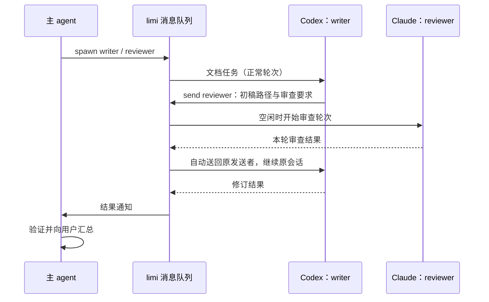

# limi Agent 协作设计

状态：第一版已实现，等待真实 agent 沙箱联调；不代表已部署。更新：2026-10-12。

## 核心决定

采用「普通主线程 + 独立成员线程 + 持久消息队列」。主 agent 拆任务、选择实例与目录、验收结果；limi 负责启动线程、传消息、保存状态和展示输出。复用现有适配器、线程执行、审批、事件日志与 SSE，不引入第二套 agent 执行循环。

这是相对简单的方案。必要的复杂度集中在消息投递：忙时排队、请求去重、停止和重启恢复。第一版限同一 daemon，最多 3 个成员同时运行、12 个成员、30 条待处理消息；成员只能联系现有成员，不能继续招募。每个成员绑定一个 cwd，多个目录用多个成员表达。

## 开源项目的做法

| 项目与来源 | 已核对的做法 | 本项目取舍 |
|---|---|---|
| [agent-deck Conductor](https://github.com/asheshgoplani/agent-deck/blob/main/docs/conductor/README.md)、[CLI](https://github.com/asheshgoplani/agent-deck/blob/main/skills/agent-deck/references/cli-reference.md) | 主控是普通持久会话；CLI 指定目录创建子会话、发送消息和读取输出；完成通知落盘，主控在轮次边界或心跳时取回 | 借鉴普通会话、CLI、父子关系、持久通知；使用 Hub 已有结构化事件，不引入 tmux、心跳推理和它的配置目录管理 |
| [OpenCode Agents](https://opencode.ai/docs/agents/) | primary 调用 subagent，子会话可进入查看并返回父会话 | 借鉴主对话内展示子任务、保留独立上下文 |
| [Goose Subagents](https://github.com/aaif-goose/goose/blob/main/documentation/docs/guides/context-engineering/subagents.mdx) | 委派任务可串行或并行，展示子 agent 工具活动并返回结果 | 借鉴任务委派和结果摘要，不引入 recipe 系统 |
| [Claude Squad](https://github.com/smtg-ai/claude-squad#how-it-works) | tmux 管理多个终端会话，git worktree 隔离工作副本 | 借鉴 worktree 作为可选隔离方式；它的会话管理本身不足以完成主 agent 自动指挥的闭环 |

目录不能只写在提示词里。OpenCode 的[跨目录子会话讨论](https://github.com/anomalyco/opencode/issues/36605)明确涉及 cwd、本地指令加载和跨目录结果回传。该 issue 是需求与插件实践记录，不能据此认定其主线已经支持。我们的子线程应通过现有 `adapter.start({ cwd })` 在目标目录启动，由 agent 自己加载项目指令。

## Claude Team 的启发

[Claude Code Agent Teams 官方文档](https://code.claude.com/docs/en/agent-teams)描述了主控、独立 teammate、共享任务列表和 mailbox。成员有自己的上下文，可以直接联系其他成员，结果自动通知主控。它提供了通信与任务协调的参考；此处不把 Claude 的产品内部实现视作可直接复用的开源协议。

limi 借鉴独立会话和邮箱，先不做共享任务依赖图。消息保存在自己的 SQLite 中，经各适配器启动正常轮次，因而可以跨 Codex、Claude 等实例。不会读写 Claude Team 的内部邮箱或修改 agent 原生会话文件。

## 用户入口

1. 在输入框工具栏点「协作」，选择允许使用的已有目录，再点「启用协作」。已有线程要等当前轮结束；新线程可以在发送第一条消息前启用。
2. 输入 `@`，选择可用实例或已有成员。选实例表示请主控创建成员；选成员表示继续原线程。新成员的标签可选择目录，默认继承主线程。当前启用时默认允许所有可用且支持协作环境的实例，API 也支持显式限制实例集合。
3. 用自然语言说明分工，例如「让 Codex 写设计文档，让 Claude 审查，修改完成后你再验收」。`@` 被作为结构化对象校验并随任务提供给主 agent，不会仅凭选中标签就启动工作。
4. 宽屏时对话右侧留白处出现智能体卡片，放不下时顶栏右侧出现智能体标记。打开后先看成员列表，点击成员查看实时输出、工具调用和审批。

默认在原目录工作，不自动创建 worktree。相同文件的修改由主控串行安排；审查时暂停对被审查文件的写入。文件分工是约定，不是文件锁。可以选用已有 worktree 目录，合并、分支操作和最终验证仍由主控安排。

## 命令怎么给 agent

不要求用户安装 Skill。启用协作后，适配器在启动或恢复进程时传入运行期环境：CLI 所在 PATH、专用 Unix socket 地址和线程范围凭据。已存在的空闲进程会先关闭，再按原生会话 ID 恢复，以加载环境；不更改项目目录、账号配置或原生历史文件。

每个正常轮次会附加一小段协作说明，告诉 agent 自己是主控还是成员、允许目录、命令与通信规则。它属于本轮输入，界面隐藏这段运行说明。凭据只在进程环境内，不写进提示词或协作数据库。Skill 可在以后承载复杂分工经验，不作为功能可用的前提。

命令使用 JSON 返回结果；错误通过非零退出码和错误文本返回。当前没有单独的稳定机器错误码体系。

| 命令 | 用途 |
|---|---|
| `limi agents` | 本次协作允许的实例及能力 |
| `limi spawn --agent ID --name NAME [--cwd DIR] [--model ID] [--effort LEVEL] --message-file FILE --request-id KEY` | 创建成员并派发首轮，立即返回消息 ID 与成员线程 ID；不指定模型和思考强度时用用户为该实例设的默认值 |
| `limi send NAME --message-file FILE --request-id KEY` | 向成员或 `lead` 追加要求；忙时排队 |
| `limi status` | 查看成员、状态及最近消息 |
| `limi result ID` | 读取指定消息的状态和结果摘要 |
| `limi stop NAME` | 主控停止某个成员，并取消该成员的排队消息 |

`FILE` 可以为 `-`，从标准输入读取。长任务优先用文件，避免 shell 转义。成员名由主控指定且在团队内唯一；`lead` 保留给主控。相同发送者的同一个 request-id 只能代表同一请求，重复调用返回原记录，不重新派发。

示例（实例 ID 先通过 `limi agents` 查询）：

```bash
limi spawn --agent codex --name writer --message-file /tmp/write-task.txt --request-id write-1
limi spawn --agent claude --name reviewer --message-file /tmp/review-task.txt --request-id review-1
limi send reviewer --message-file /tmp/review-ready.txt --request-id review-ready-1
```

## 来回通信



显式任务结束后，结果回给发送该任务的人；成员处理结果通知后产生的输出则回到主控。主控处理结果不再生成自动回复，从机制上避免纯通知互相应答。消息标明来源，成员发言不当作用户授权。提示词要求无事可做就结束本轮等待，不轮询、不互发空确认。

一轮结束仅标「已返回」，不是需求已完成。汇总使用适配器已提供的文字事件，最多保留 16000 字符，不额外调用模型生成摘要。完整过程保留在子线程事件日志。第一版逐条投递，尚未合并同一接收者的多个通知；可能增加主控轮次，是后续可优化的成本点。

## 数据与恢复

`coordination` 表每个主线程一条记录，保存允许目录、实例、暂停状态、成员别名与线程 ID，以及消息记录。消息含发送者、接收者、文本、去重键、类型、状态、执行轮 ID、结果和创建时间。`ThreadView.coordination` 提供主线程 ID 与成员数，前端无需识别 agent 品牌。

状态为 `queued → running → returned / failed / stopped / interrupted`。开始投递时，在同一 SQLite 事务内关联消息与 `turn.started`；再由现有 `ThreadManager` 执行。已有用户排队消息优先。忙碌和等待审批都占用运行名额。

- 停止主线程：暂停协作，停止所有成员与排队消息；迟到结果不得再次唤醒主控。用户再给主线程发消息即继续，不必另按按钮。
- 停止单个成员：停止该成员当前任务及排队消息，其他成员继续。
- daemon 重启：先沿用 `recoverInterrupted()`，协作不因重启而暂停（暂停只来自用户停止）。未结束任务标中断，不自动重跑可能已产生文件修改的工作；原本排队的消息在重启后继续投递。
- 若任务已记录结束而结果尚未入邮箱就重启，从已记录的事件重建结果通知并按稳定 ID 去重。
- 第一版协作线程保留关系与消息，拒绝删除，可归档。归档主线程会阻止新的自动投递。

这不保证外部文件写入恰好发生一次；明确的中断状态比盲目重试更可靠。

## 界面

参考用户提供的 Codex 截图，采用「右上角入口 → 成员列表 → 输出详情」。另参考 [OpenCode 子会话导航](https://opencode.ai/docs/agents/#usage)、[Goose 可展开子任务](https://github.com/aaif-goose/goose/blob/main/documentation/docs/guides/context-engineering/subagents.mdx)、[agent-deck Command Center](https://github.com/asheshgoplani/agent-deck/blob/main/docs/COMMAND-CENTER.md)。这些是文档调研，未运行参考项目的 UI。

- 桌面右侧列表约 390px，详情约 600px，随屏幕收窄；手机全屏显示。
- 列表保持创建顺序，显示成员名、实例、目录、运行/待批准/返回等状态、最后任务或结果摘要、未读标记。「消息」页签按聊天频道的样子列出成员间消息：头像用实例图标，名字后标实例，结果折叠在对应任务下面，正文按 Markdown 显示。
- 详情复用 `ThreadView`、历史分页、工具步骤和审批；只订阅当前详情的 SSE，按事件序号续传。向上阅读时停止自动滚动，可点击「查看最新输出」。
- 详情不放独立输入框；提供「让主智能体调整」「展开查看」「停止任务」。展开完整子线程后有「返回主线程」。
- 手机浏览器返回依次回列表、主对话；桌面 Esc 关闭。关闭视图不停止工作，不启动新任务，主线程草稿保留。
- 文件面板与智能体面板互斥。侧栏默认隐藏子线程，通过面板进入；当前展开的子线程可显示在侧栏。

第一版仅展示 limi 创建的成员；agent 内部原生 subagent 不会自动出现在这里。未实现侧栏子线程搜索标注、主对话可点击派发卡片、入口审批计数和用时汇总，后续按实际需要补齐。

## 接口与文件

| 文件 | 职责 |
|---|---|
| `packages/daemon/src/coordination.ts` | 成员、持久队列、范围校验、并发、结果和专用 IPC |
| `packages/daemon/bin/limi` | 无新增依赖的 CLI 客户端 |
| `store.ts` / `threads.ts` | SQLite、原子关联轮次、现有会话执行与停止 |
| `adapters/` | 运行期环境传递、`capabilities.coordination` |
| `http.ts` | 认证后的协作设置、查询、继续和停止 API |
| `packages/web/src/components/AgentPanel.tsx` | 列表、详情、实时输出与手机返回 |
| `Composer.tsx` / `App.tsx` | 启用入口、@ 对象、目录选择和面板集成 |

浏览器使用已有认证：`GET /api/threads/:id/coordination` 查询，`POST` 启用，或带 `action: resume / stop`。发送消息的现有 turns API 接收 `mentions`。CLI 使用单独 socket 的 `POST /command`，不能调用批准、全局设置和删除等管理接口。

cwd 检查 daemon 白名单及协作允许范围，解析符号链接真实路径。成员按目标实例的默认权限策略创建，不因为协作自动提高权限。仅做应用范围限制；同一 OS 用户下仍沿用 agent 原有沙箱与本项目信任模型，不声称实现系统级隔离。

## 验证与后续

自动测试覆盖运行期环境、真实 CLI 请求、假 Codex 写文档与假 Claude 审查返工、消息去重、范围校验、并发排队、审批、停止和恢复；浏览器覆盖 @、详情只读、草稿、手机返回及四种尺寸/主题组合。具体验证结果记录在 `TODO.md`。

真实 Codex / Claude 在各自沙箱中能否继承环境并访问专用 socket，尚需实际联调。能力标记表示适配器能传递环境，不代表所有外部 agent 版本及沙箱组合已验证。遇到限制应明确报错，不自动扩大权限。

暂不做跨机器成员调度、DAG 编辑器、角色市场、共享记忆、自动合并或另一个 npm 调度框架。第一版直接随现有 daemon 构建，先验证用户只与主 agent 沟通就能完成派发、反馈和验收。
