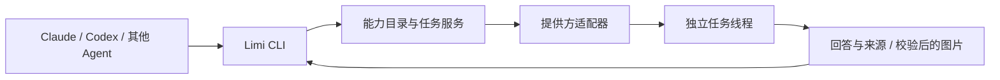

# Agent 能力借用：生图、搜索、网页读取与浏览器操作

目标是让 Limi 中的 Agent 按需使用别的 Agent 的能力。调用方通过统一 CLI 发现能力、加载参数并提交任务，不需要了解各家协议、复制账号凭证或连接额外 MCP。

| 提供方 | 能力 | 当前接入状态 |
|---|---|---|
| Antigravity | `image.generate` | 原生生图，返回校验后的位图 |
| Antigravity | `web.search` | 原生 `search_web`，返回回答与来源链接 |
| Codex | `web.search` | 原生联网搜索，返回回答与来源链接 |
| Codex | `web.read` | 原生打开指定网页，概括正文或回答问题 |
| Antigravity | `browser.use` | 仅提供不可用说明；尚未接入 IDE Browser Subagent 运行环境 |
| Codex | `computer.use` | 通过会话动态工具操作 Limi 独立浏览器，返回最终截图；范围为浏览器 |

Antigravity 的 IDE Browser Subagent 尚无执行桥接，发现时返回 `unavailable`，调用立即返回 503。Codex 的浏览器能力由 Limi 提供执行环境、Codex 负责看图决策，不是导出厂商桌面应用内部工具；`result.runtime: limi-browser` 与 `scope: browser` 明确区分。



## 渐进发现

每次 daemon 启动后，普通线程第一次发送非斜杠请求时只附带一句入口提示：`limi tools search 关键词`；不注入全部工具 schema、Skill 正文或账号信息。后续请求不重复提示，斜杠命令不附加参数。生图任务本身不获得借用入口或凭证，避免递归调用。

- `limi tools search "生图"`：只返回匹配能力的名称、说明、执行方式和可用性。
- `limi tools describe agy/image.generate`：才加载该能力的输入 schema。
- `limi tools skill`：按需读取仓库内置的短 Skill。也可在明确需要原生 Skill 发现时，自行安装 `skills/limi-tools`；Limi 不自动修改 Agent 的目录或配置。

能力 ID 为 `<实例 ID>/<能力名>`。同一适配器的多个账号有不同 ID，调用时明确选择实例。`unavailable` 表示 CLI 不可用或已知接入条件缺失，具体查看 `reason`；`unverified` 只表示 CLI 可启动且没有已知接入障碍，不保证当前登录、额度或原生工具一定可用。实际调用结果以任务为准。`tools describe` 返回输入 schema、`resultKind` 与权限模式。

## 调用例子

在启用此实现的 Limi 会话中，可以直接说：“借用反重力生成一张纸雕狐狸图片，并把图片展示出来。”普通 Agent 通过首次消息中的发现提示找到 CLI，自行读取 `limi tools skill`、选择能力并提交。这里的 Skill 是 CLI 按需返回的使用说明，不是自动安装到各家全局 Skill 目录；只有选中的提供方任务才收到完整任务参数。已运行的旧 Agent 进程需要新会话才能获得启动环境中的受限凭证。

在 Limi 新启动的 Agent 会话里：

```bash
limi tools search "生图"
limi tools describe agy/image.generate

# 将内容与风格写入 request.json，例如：
# {"prompt":"一只纸雕风格的橙色狐狸，奶油色背景，正方形，无文字"}
limi tools run agy/image.generate \
  --input-file request.json --request-id paper-fox-001

limi jobs wait JOB_ID --timeout 300
limi jobs fetch JOB_ID ARTIFACT_ID --output fox.png
```

搜索与网页读取复用相同命令：

```bash
limi tools search "搜索"
limi tools describe codex/web.search
# search.json: {"query":"IANA example domains 的用途"}
limi tools run codex/web.search --input-file search.json --request-id search-001
limi jobs wait JOB_ID --timeout 300

limi tools describe codex/web.read
# page.json: {"url":"https://example.com/","question":"这个域名用来做什么？"}
limi tools run codex/web.read --input-file page.json --request-id page-001
limi jobs wait JOB_ID --timeout 300
```

将 `codex`、`agy` 换成实际发现的实例 ID。搜索结果在 `summary` 和 `result.sources` 中，没有图片也可成功。来源的 `provenance` 区分原生返回的链接（`native`）与提供方回答中的引用（`answer`），不将模型给出的引用伪称为原生来源。最多返回 12 条去重来源；回答最多 16000 字符，截断时 `summaryTruncated: true`，完整回复在执行线程里按需读取。

`--input-file -` 从标准输入读取 JSON，内容不插值成 shell 命令。输出默认 JSON；也接受 `--json`。

`jobs get` 查询，`jobs cancel` 取消。等待超时不会取消底层任务；返回 `timedOut: true`，继续使用同一个任务 ID 查询。`waiting: true` 表示需要在任务线程处理原生请求。`jobs wait` 成功退出码为 0，未成功为 2，调用错误为 1。下载校验大小与 SHA-256，以排他写入创建文件，不覆盖现有文件。CLI 可使用 `artifacts[].id` 或 `name` 下载，底层接口仍使用 ID；产物丢失时明确返回错误，不创建下载文件。

同一个调用线程和 `request-id` 对应同一任务，重试不会再次生图；同一个 ID 换了参数返回 409。失败后明确重新生成时要换一个 ID。

## 执行与产物

Limi 为每次任务创建独立 scratch 线程和工作目录，用提供方自身登录态启动原生 CLI。保留原生事件、消耗、权限错误和回复，任务中的 `threadId` 可定位执行记录。首版不增加新 UI，沿用线程页与图片查看器。

Antigravity 适配器支持两种已知原生执行记录：

1. `generate_image` 工具成功结束。
2. `invoke_subagent` 成功调用内置 `image-generator`。当前 CLI 的主 Agent 不直接持有生图工具，通常走这一条。`--agent image-generator` 不适用，它只选择自定义 Agent。

需要同时满足执行记录和实际图片文件校验，才将任务标成 `succeeded`。图片只能来自该任务工作目录或适配器登记的原生会话产物目录；解析真实路径，拒绝目录外的软链接，不因回复里提到任意文件就授权读取。仅接收 PNG、JPEG、WebP、GIF，每张不超过 20 MB，最多保留四张并按哈希去重。将校验后的图片复制到 daemon 的产物目录，后续查询不重新读取完整事件或扫描原生会话。

反重力任务以 `auto_edit` 权限启动，不继承其普通线程的完整权限默认值，也不因失败自动提高权限。原生拒绝时保留 `permission_refused`。要求主 Agent 等待 image-generator 的完成消息，直接使用返回路径，避免读取不需要的子 Agent 日志。

搜索必须有匹配的原生工具成功结束事件，网页读取必须有指定 URL 的原生打开记录；纯文本回答、shell 查询或其他工具不能作为执行证据。Codex 仅在借用的网页任务会话中通过 `thread/start` 配置 `web_search: live`，权限为 `ask`（只读沙箱）；不修改用户配置或普通线程设置。事件中仅保留有限的 URL/标题元数据，不把完整原生搜索正文堆入工具事件。校验表示原生能力确实执行，不承诺每个结论都正确；失败为 `result_unverified`，生图校验失败仍为 `artifact_unverified`。

## Computer use 的运行环境

```bash
limi tools search computer
limi tools describe codex/computer.use
# request.json: {"url":"https://example.com/","task":"检查页面标题与正文，返回截图"}
limi tools run codex/computer.use --input-file request.json --request-id browser-check-001
limi jobs wait JOB_ID --timeout 300
limi jobs fetch JOB_ID ARTIFACT_ID --output browser.png
```

执行链路为：调用方 Agent → Limi CLI → 独立 Codex 任务 → `limi_computer` 动态工具 → 独立 Chromium → 截图返回 Codex → 下一步操作。适配器只在该任务的 `thread/start` 注册动态工具，处理 `item/tool/call` 并返回图像；普通 Codex 会话不注入此工具。协议见 [Codex App Server](https://learn.chatgpt.com/docs/app-server)。

主机须安装 Chrome 或 Chromium，可通过 daemon 环境变量 `LIMI_BROWSER_EXECUTABLE` 指定可执行文件；默认尝试 Playwright 浏览器缓存与常见系统安装位置。不自动下载安装浏览器，不关闭 Chromium 沙箱。没有可执行文件时发现接口返回不可用；如果系统不能启用浏览器沙箱，任务明确失败，不自动降低隔离。

每次任务创建独立的无头浏览器和临时配置，固定视口 1280×800。支持导航、截图、坐标点击、键盘输入、按键、滚动、短暂等待与结束；没有 DOM 脚本执行、任意 shell、文件上传下载、现有浏览器接管或操作系统桌面控制。当前只支持一个窗口，弹窗关闭，原生对话框取消。导航只接受无嵌入凭证的 HTTP(S)；这是协议限制，不是网络隔离，允许访问用户明确指定的本地开发页面。登录态不从用户浏览器复制。

动作串行执行，最多 60 次、浏览器时间五分钟；完成、取消、会话关闭与进程断开都会关闭浏览器。每步截图直接返回提供方，不写入持久化事件正文；事件仅存操作、URL、计数和最终文件路径。只有宿主实际处理 `finish` 并写出截图才形成执行证据，再经过现有产物边界与格式校验。`succeeded` 表示执行证据与产物合格，不是业务任务效果的独立判定，仍应查看回答与截图。最终截图可通过统一 `jobs fetch` 下载。

## 用户本人的浏览器

Computer use 每次开一个全新浏览器，没有登录态。`limi/browser` 相反：它是用户本人在这台机器上的浏览器，人通过 Limi「桌面」登录一次（例如邮箱），agent 之后直接沿用，网页从这台机器的网络访问。它不是委托给另一个 agent 的任务，`mode: direct`，没有任务和产物，agent 用 [agent-browser](https://github.com/vercel-labs/agent-browser) 的命令直接操作。

```bash
limi tools search 邮箱          # 找到 limi/browser
limi tools describe limi/browser  # 用法和注意事项，只在需要时读取
limi browser tab new https://mail.google.com/
limi browser snapshot -i          # 可交互元素，带 @eN 编号
limi browser get attr @e7 href    # 取链接地址而不点击
```

`limi browser ARGS` 等于 `agent-browser ARGS`：Limi 先确保浏览器在运行（`browser.ensure`），再带上 `AGENT_BROWSER_CDP`、`AGENT_BROWSER_CONTENT_BOUNDARIES=1`（网页内容包在不可信标记里）、`AGENT_BROWSER_IDLE_TIMEOUT_MS=600000` 和 `AGENT_BROWSER_SESSION=limi` 启动 agent-browser，参数、输出和退出码原样传递。调用方自己设置的同名变量优先。不带参数返回 CDP 地址。

浏览器由 daemon 按需启动：有界面的 Chrome（优先 Google Chrome，Google 登录信任它）显示在 VNC 桌面上，配置目录默认在数据目录 `browser/profile`，权限 0700。调试端口由 Chrome 在本机随机选择，从配置目录的 `DevToolsActivePort` 读取。daemon 退出不关闭 Chrome，重启后按配置目录找回，登录和标签页不受影响。配置目录正被一个没有调试端口的 Chrome 使用时，返回错误而不再启动第二个。没有桌面时 `availability: unavailable` 并给出原因。

agent-browser 不随 Limi 安装：npm 包带所有平台的二进制，约 115 MB。用 `npm install -g agent-browser` 安装，或用 `LIMI_AGENT_BROWSER` 指定路径；找不到时搜索和 `describe` 返回 `unavailable`，`reason` 让 agent 先征得用户同意再安装；装好后下次查询即可用，不用重启 Limi。

边界：这是同一系统用户下的约定，不是沙箱。agent 本来就能执行命令，Limi 不把浏览器包装成权限层；点击、提交、发送这类操作由 agent 自己的审批模式和用户把关，`describe` 的用法里要求先征得同意、一次性链接只取地址。浏览器只给普通会话，借用任务的执行线程没有凭证。管理员凭证可调用 `browser.ensure` 和 `browser.open {url}`（只接受 http(s)，在新标签页打开），供界面使用。

## 接口与凭证

普通会话的进程环境提供 `LIMI_TOOLS_SOCKET`、`LIMI_TOOLS_KEY` 和 `LIMI_BIN_DIR`。这些值只存在于启动上下文，不写入 Agent 配置文件；PATH 加入 CLI 所在目录。凭证每次 daemon 启动重新生成，仅能调用能力服务、查看和取消本线程发起的任务、下载本线程的产物，不能操作其他线程或批准权限请求。新会话不继承父进程的借用凭证或 hub 管理 token。

能力 socket 是 daemon 数据目录中的 `tools/limi.sock`，由现有私有 socket 机制限制文件权限。这是 API 作用域隔离，不是对同一操作系统用户下任意进程的沙箱隔离。

外部程序可以显式设置 `LIMI_URL`、`LIMI_TOKEN` 使用相同 CLI。该 token 是现有 hub 管理凭证，不应交给普通 Agent。对应 HTTP 接口：

| 接口 | 行为 |
|---|---|
| `POST /api/tools/command` | `tools.search`、`tools.describe`、`tools.run`、`jobs.get`、`jobs.cancel` |
| `GET /api/tool-artifacts/:job/:artifact` | 下载指定产物，要求现有 bearer 鉴权 |

内部 socket 使用相同 command JSON 和 `/artifacts/:job/:artifact`，按线程凭证进一步限制访问。

## 恢复与边界

任务和幂等键存入 hub SQLite。状态为 `queued`、`running`、`succeeded`、`failed`、`cancelled` 或 `interrupted`。重启时使用已持久化的结束事件核对结果；没有结果的任务标记中断，不自动重放可能收费的操作。全局最多四个未结束任务。

这仍是一次原生 Agent 任务委托，不是把厂商应用内部工具直接导出成 API。CLI 版本、账号、额度和权限都会影响结果。后续能力通过适配器的 `borrowedTools` 增加，CLI、鉴权、任务和产物协议复用。

本机实测 Antigravity CLI 可搜索，但主 Agent 没有可调用的 `read_url_content` 和 Browser Subagent；Codex CLI 可搜索与打开网页，但没有暴露原生桌面控制工具。因此浏览器控制采用 Limi 自己的浏览器运行环境加 Codex 会话动态工具；原生操作系统桌面控制仍未接入。后续可扩展多窗口交互、截图尺寸与原生图片编辑，需继续明确执行范围和输入文件授权。

## 验证

`packages/daemon/test/borrowing.test.ts` 使用真实 CLI 进程与假 ACP/反重力进程验证跨 Agent 调用、渐进发现、产物下载、不同实例 ID、幂等冲突、权限隔离、无图片/错误图片/越界软链接、取消、超时及恢复。`borrowing-web.test.ts` 与 `borrowed-web.test.ts` 覆盖两家搜索、网页读取、原生执行证据、URL 限制、来源区别及不可用能力的提前拒绝。原生能力与真实账号的验证另行记录，不用假进程测试代替实际验收。

原生协议参考：[Headless mode](https://antigravity.google/docs/cli/headless/)。

2026-10-20 生图阶段的独立 worktree 验证记录：

- `npm run typecheck && npm test && npm run build` 通过；全量测试 924 项通过、1 项跳过、0 项失败。新增借用测试 13 项。
- 真实 Claude ACP 会话通过受限 CLI 读取 Skill、查询参数、提交一次请求，借用真实反重力生成图片，等待并下载 JPEG。任务为 `succeeded`，下载校验通过；调用方与提供方均使用 `auto_edit`。
- 真实 Chromium 检查桌面 1440×1000、手机尺寸 390×844，亮色与深色，图片正常加载且可放大。图片绝对路径、相对路径及工作目录别名合并为一个展示项；其他目录的同名图片仍保留。长文件路径在图片宽度内省略显示，不再撑宽卡片、在图片右侧露出背景。未测试手机真机。
- 生成图片和浏览器截图保存在 worktree 的 `.cache/borrow-image/`，不纳入版本库。实现保留在 `feature/borrow-image`，待用户验收，当前运行的 hub 未切换到此分支。

2026-10-20 搜索扩展与审查修复记录：

- 再次执行 `npm run typecheck && npm test && npm run build`，全部通过。新增输入/来源校验、两家原生搜索与网页读取的假进程集成、不可用能力提前拒绝，以及四类审查问题的回归覆盖。
- Limi 任务服务分别调用真实 Antigravity 搜索、Codex 搜索和 Codex 网页读取，三项均为 `succeeded`，返回持久化的回答与来源；网页读取使用固定示例页面核对。
- 真实 Claude ACP 会话通过运行时的 Limi CLI 发现并提交一次 `codex/web.search`，等待成功后给出来源与任务 ID。未注入完整工具目录，未手工替 Claude 调用搜索。
- Antigravity 审查提出的下载错误格式、无工具名的原生子任务识别、产物名称下载及带标题/空格的 Markdown 图片路径问题均已修正；对应回归通过。下载接口继续按不可变 ID 定位产物，CLI 接受名称并解析成 ID。
- 真实 Chromium 查看搜索结果：桌面 1440×1000、手机尺寸 390×844，亮色与深色均有可点击来源链接，无横向溢出或页面错误；截图在 `.cache/borrow-web/`。未测试手机真机。
- Computer use / Browser use 尚未接通原生控制运行环境，不能作为已可用的执行能力验收。改动仍在独立 worktree，当前 hub 未切换。

2026-10-21 Computer use 接入与复核记录：

- `codex/computer.use` 接入 Codex 会话动态工具与 Limi 独立 Chromium，范围为浏览器。实测 Codex CLI 0.160.1；操作系统桌面和反重力 IDE Browser Subagent 仍未接入。调用参数、环境要求和限制见上文。
- 真实 Codex 根据截图在本地验收页面找到 Name 输入框，填写 `Limi`、点击 Submit，并检查页面显示 `Submitted: Limi`；8 步后保存最终截图，任务为 `succeeded`。服务端也收到预期的表单值。
- 真实 Claude ACP 会话按需读取能力与 Skill，发起且仅发起一次 `codex/computer.use`，等待结果、使用 `jobs fetch` 下载图片并返回链接。提供方浏览器启用 Chromium 沙箱；调用方未自行操作浏览器。截图为 1280×800，下载文件与任务产物的 SHA-256 一致。
- `computer.test.ts` 的 8 个用例通过，覆盖参数校验、启动取消、真实浏览器表单交互、动态工具证据、事件体积、错误回合、缺失证据和普通会话无工具注入。`npm run typecheck && npm test && npm run build` 全部通过。
- 真实 Chromium 查看调用方结果：桌面 1440×1000、手机尺寸 390×844，亮色与深色均能显示截图，无横向溢出或页面错误。发现横图外框仍可能宽于图片，已将最大宽度限制移到外框；横图及带长路径的方图再次检查通过，边框与图像宽差仅为两侧边框。随后前端构建通过。未测试手机真机。
- 实测图片与界面截图保存在 `.cache/borrow-computer/`，不纳入版本库。Antigravity 对新增浏览器运行环境、动态工具适配、证据、生命周期和隔离边界进行了只读复核，未报告新的可定位缺陷；主控核对了实现和实测结果。
- 以上实测在独立 worktree 中进行。合入后使用 `scripts/restart.sh` 构建并重启服务；新启动或重新建立连接的 Agent 会话获得发现提示和受限 CLI 凭证。已有进程不能通过只更新文件获得新环境。
