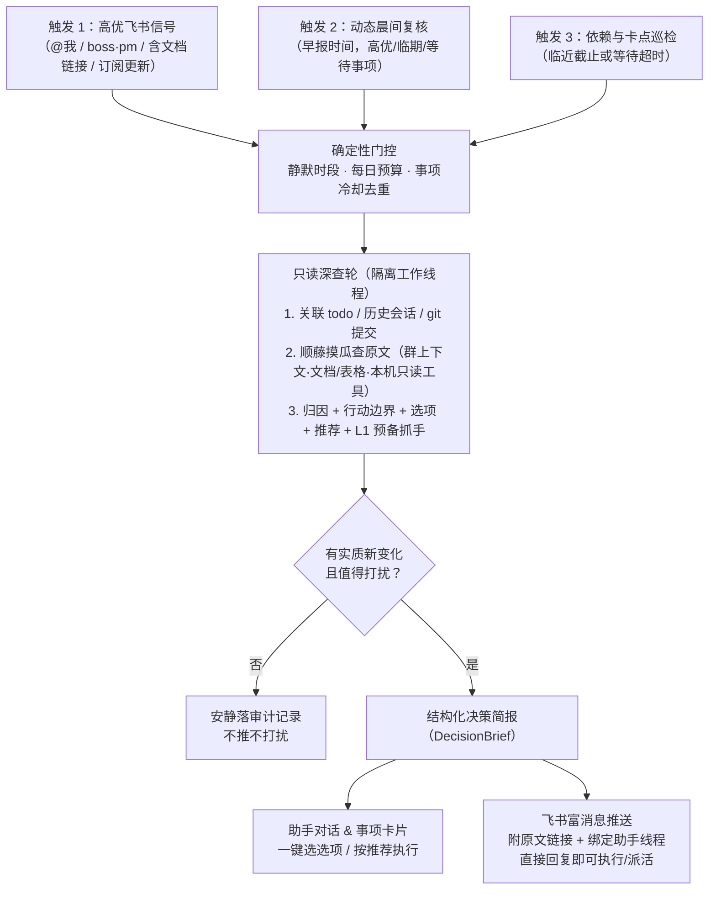

# 深度主动：关联查证、深层归因与决策简报（方案 B）

2026-11-25 · 设计稿，待确认后实施。接在 [主动行动分级](proactive-design.md)、[助手对话](assistant-chat-design.md) 和 [Superagent](superagent-design.md) 之后。

## 为什么做

现状的「主动」停在表层：

1. **信息源浅**：[channels/lark.ts](../packages/daemon/src/channels/lark.ts) 只保留 300 字摘要，不提取消息里的文档/表格链接、不拉群上下文；[personal-router.ts](../packages/daemon/src/personal-router.ts) 的 `SIGNAL_RULES` 限制收到信号后只调 `calli todo / notify` 且回复 ≤ 100 字，Router 不会顺藤摸瓜核实原文。
2. **早报与盘点静态**：[personal-brief.ts](../packages/daemon/src/personal-brief.ts) 明确不读接续说明、不查外部、不调模型，硬压 100 字内；[personal-review.ts](../packages/daemon/src/personal-review.ts) 禁止读关联会话历史。它只是复读本地旧清单，不是核查外部最新现场。
3. **缺少「决策闭环」**：现有 `ProactiveRun` 只有一句 `question` 和简单字符串选项，没有**关联脉络、深层归因、可选动作、利弊对比、默认推荐和提前备好的抓手**；且 [push.ts](../packages/daemon/src/push.ts) 屏蔽 `proactive` 推送，推送消息与 [feishu-chat.ts](../packages/daemon/src/feishu-chat.ts) 断开，在飞书里回复无法直接触发执行。

目标：把 Calli 的主动从「浅提醒」升级为五步深度决策流——**找 todo → 跨源关联与深层归因 → 你能做什么 → 你的选择是什么 → 帮你选好的推荐与预备抓手**，并打通「飞书/助手一键拍板 → 直接派活执行」。

## 开源参考与取舍

- **LangGraph Ambient Agents**：事件/定时触发 → 确定性门控（规则与预算）→ 隔离的多步只读深查 → 结构化 HITL 拍板中断（带推荐与选项）→ 人拍板后恢复执行。
- **OpenClaw**：主动简报直达日常聊天网关并支持原地回复续接，调查过程放在隔离上下文，不污染主对话。
- **LoopX / Persona**（本仓已有参考）：以事项账本为唯一状态中心，区分只读核查/L1 备稿与 L3 对外动作，无实质变化保持静默。

**取舍**：复用 Calli 现有事项账本（`todos` + `TaskLedger`）、飞书通道（`channels/lark.ts` + `feishu-chat.ts`）、推送（`push.ts`）和 `ProactiveRun`，不另建第二套任务或消息系统；不硬编码企业内部私有表结构，调查层通过「内置只读能力 + 本机已授权 CLI/MCP 工具」按线索深查；严格守住 `VISION.md`（不改 agent 配置、L3 对外动作永远要人点头）和 `LESSONS.md`（不往首屏堆新控件）。

## 整体链路



## 分阶段设计

### 阶段 1（本次先落地核心闭环）

#### 1. 信号富化（`packages/daemon/src/channels/lark.ts`）

- 保留消息正文至 1500 字（原 300 字硬截断仍用于列表预览，完整正文留给归档与深查）。
- 确定性提取消息里的 `https://` 链接列表（飞书文档/表格/多维表/妙记/外部链接）及 `chatId`、`chatName`，存入 `LarkSignal` 元数据，供深查直接顺藤摸瓜。
- 判定「高优触发信号」的确定性规则：`atMe` / `senderRole === 'boss' | 'pm'` / 包含文档或表格链接 / 命中已订阅线程的新消息。

#### 2. 深度调查执行器（新模块 `packages/daemon/src/proactive-investigate.ts`）

- **运行形态**：复用 `personal.acquireWorkThread` 或隔离的只读调查轮（类似现有 `prepare`，cwd = 个人目录，不污染助手主对话），允许调用：
  - Calli 内置只读命令：`calli todo --ledger`、`calli todo show`、`calli threads --query`、`calli threads show`、`calli signals show/material`；
  - 本机已授权的只读工具（`lark-cli` 读群上下文/文档/表格、本地仓库只读 `git log/status`、已安装的只读 MCP/CLI）。
- **硬边界**：调查轮明确禁止改外部仓库、禁止推远端、禁止对外发消息/评论/改表格、禁止付款或删除；仅允许把 L1 预备草稿写入个人目录 `matters/<id>/artifacts/`。
- **诚实核查约束**：必须区分「已查证事实（附来源/链接）」「未查到或无权限（显式写出缺口）」；查不到的绝不编造。
- **结构化产出 `DecisionBrief`**（daemon 校验 schema、长度与链接合法性；解析失败退化为审计记录，不发半成品）：

```ts
export interface DecisionOption {
  id: string;                 // 'opt-1' | 'opt-2' | 'opt-3'
  label: string;              // 简短动作名，≤ 24 字
  action: string;             // 选了这个会做什么
  tradeoff: string;           // 代价 / 风险 / 依赖
  /** 选中后若可交给 Calli 直接开工，附只读建议派活参数（不自动执行） */
  dispatch?: { agent?: string; cwd?: string; task: string };
}

export interface DecisionBrief {
  worthy: boolean;            // false 表示无实质变化或已解决，静默结束
  matterId: string;           // 命中的已有 todo ID，或 '' 表示建议新关注
  headline: string;           // 一句话结论，≤ 60 字
  attribution: string;        // 深层归因：现场查到了什么、真正卡在哪
  evidence: Array<{
    label: string;            // 例：「迁移全量表」「迁移群 16:20 消息」「会话：修复导出」
    fact: string;             // 查证到的具体事实
    url?: string;             // 仅允许 https://
    threadId?: string;        // 本地 Calli 会话 ID
  }>;
  gaps?: string[];            // 没查到或无权限的数据源，如实列出
  canDo: {
    user: string[];           // 需要人拍板或出面的事
    agent: string[];          // Calli 可以代做的事
  };
  options: DecisionOption[];  // 2–3 个具体选项
  recommendedId: string;      // 必须命中 options 之一
  recommendReason: string;    // 为什么推荐这个
  prepared?: {                // L1 提前备好的抓手（可选）
    label: string;            // 例：「已起草群回复文案」「已整理值班备注」
    artifactPath?: string;    // 个人目录内相对路径
    preview: string;          // 摘要预览
  };
}
```

- **归属到现有模型**：复用 `ProactiveRun`（新增 `kind: 'investigate'` 与可选 `brief?: DecisionBrief`），沿用 `asking / answered / discarded / observed` 状态机、每日预算上限（默认每天深查 ≤ 8 次，单事项 6 小时内不重复深查）和静默时段。
- **三档模式兼容**：
  - `off`：不触发自动深查；
  - `observe`：只跑规则候选记录「本会对哪件事做深查」，不调深查模型；
  - `auto`：自动跑只读深查，产出 `DecisionBrief` 卡片与推送；人点击选项或回复才触发后续行动。

#### 3. 动态晨间复核（升级 `personal-brief.ts` & `personal-brief-schedule.ts`）

- 保留原静态 `buildBrief` 作为零成本回退（无可用 agent、深查关闭或预算用完时仍照常发静态早报）。
- 新增配置项 `brief.deep`（布尔，默认关闭或随主动模式开启，见待确认项）：开启后，早报触发时挑出 Top 3–5 件「今日最优先 / 临期 / 等待他人超 24h」事项，触发一次批处理动态复核——带着每件事的 `source`、关联线程和接续说明重查一遍外部最新变化，合成一份有归因、有原文链接、有拍板选项的晨间简报。

#### 4. 富决策推送 + 飞书原地回复闭环（`push.ts` & `feishu-chat.ts`）

- **突破过紧字数墙**：决策简报推送按结构化 Markdown 渲染（上限放宽到 2,000 字，仍保留清晰分节：结论 → 核查事实与链接 → 你的选择 → 推荐与预备抓手）；`SIGNAL_RULES` 不再对高优调查结果强压 100 字。
- **飞书回复直接续聊执行**：
  - 若专用机器人（[feishu-chat.ts](../packages/daemon/src/feishu-chat.ts)）已启用并绑定主人，主动决策简报优先经专用机器人发送，并把返回的 `message_id` 通过 `store.feishuLink(sentId, null, routerThreadId)` 绑定到**助手（Router）线程**；
  - 你在飞书里回复这条简报（如“按推荐的办”“选 2，顺便把草稿改成更委婉一点”），消息直接进助手线程，带着该 `DecisionBrief` 上下文，由助手在当前人发起轮内直接执行或 `dispatch --now` 给 coding agent。
  - 未启用飞书对话时，平滑回退到现有 [push.ts](../packages/daemon/src/push.ts) 推送通道。
- **Calli 网页端呈现（遵守 `LESSONS.md` 第 2 条）**：
  - 不新增首屏导航或常驻浮窗；
  - 复用助手对话流与 [ProactiveRuns.tsx](../packages/web/src/components/ProactiveRuns.tsx) 的决策卡：展示归因、可点击出处链接、选项按钮（推荐项高亮为 `primary`）、可展开查看预备草稿，点选后把选择发回助手线程执行。

### 阶段 2（按阶段 1 真实反馈决定是否推进）

- **高频告警群降噪状态机**：对指定值班/告警群维护「触发 / 恢复 / 未 ACK」状态表，按窗口归并后仅在仍有未恢复 Critical 时触发深查并自动生成值班备注草稿。
- **更多外部数据源连接器**：视宿主权限情况，通过 Calli 扩展机制接入邮件或外部工单/看板数据源。

## 验收与衡量

### 自动化验证（交付前必须通过）

- **daemon 单测**：
  - 信号链接提取、高优判定与冷却去重；
  - `DecisionBrief` 校验（缺推荐项、非法 URL、非 JSON 降级为审计记录；`worthy: false` 静默不推）；
  - 动态早报触发、失败回退到静态 `buildBrief`、静默时段与每日预算拦截；
  - 飞书主动发送 `message_id` 绑定到助手线程，用户回复该消息正确路由回助手线程而非新建空线程；
  - 假 agent（`packages/daemon/test/fixtures/`）端到端走通：高优信号 → 只读深查 → 产出 `DecisionBrief` → 点选推荐项触发后续动作。
- **web 单测与浏览器验看**：
  - 决策简报卡片（推荐项、证据链接、缺口提示、预备草稿展开、点击选择）单测 + 三语 i18n（`zh / en / ja`）+ `ui-budget.test.ts` 不超预算；
  - 无头 Chromium 桌面 1440 / 手机 390 × 亮 / 暗截图验看加载稳定与无溢出。

### 真实效果衡量（上线后 5 个工作日观察）

- **有效命中率**：推出来的决策简报中，确实帮你抓到真实漏项/卡点、而不是废话的比例 ≥ 80%；
- **打扰控制**：每日主动推送 ≤ 3–5 条，无实质变化保持静默；
- **执行闭环率**：收到简报后，直接回复或点选推荐项即可推进（而不是自己再重新翻群翻表）的比例。
- **推翻条件**：若连续 3 天发现深查受限于宿主工具权限读不到关键群/表、只能复读标题，则优先补数据源权限/连接器，而不是继续堆提示词。

## 待用户拍板（实施前只需定这三件事）

1. **阶段 1 触发范围**：是否同时做「① 动态晨间复核 + ② 高优飞书信号深查 + ③ 飞书回复直达助手执行」，还是先只做其中两项？
2. **深查的默认模型与每日预算**：深查每次跑一个只读工作轮，建议默认复用「私人设置里的 agent / model」、上限 **每天 8 次深查 + 单事项 6 小时冷却**，是否合适？（或者希望深查可单独配一个更便宜/快的模型？）
3. **宿主环境权限确认**：当前要测试验证时，是否允许我在这个 worktree 里安装/构建并跑测试（需要放行一次沙盒外的 Node 22 / `.git` 访问）？
