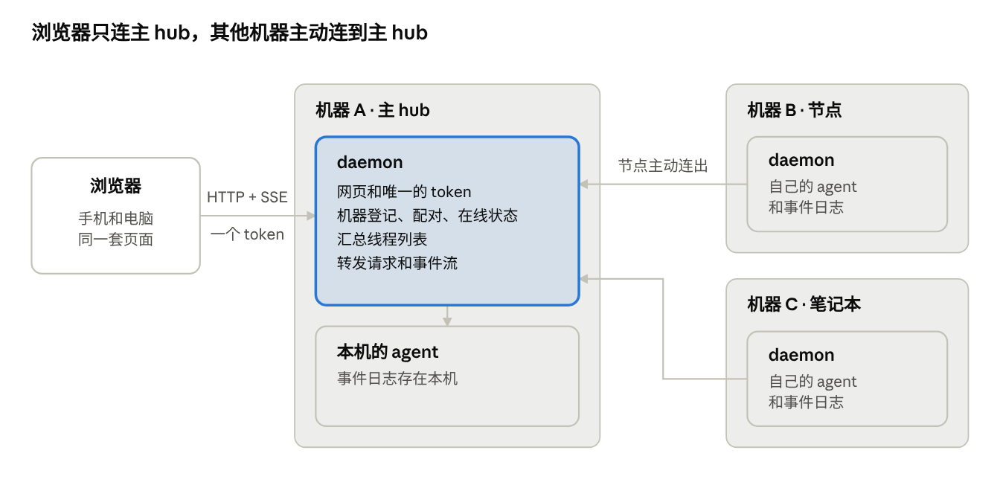

# 多机管理设计

2026-10-11 · 规划，还没有实现。要不要做、先做哪一期，看最后一节的待定问题。

## 结论

每台机器跑同一个 daemon，其中一台当主 hub。浏览器只连主 hub，其他机器用一次性配对码主动连到主 hub，由它转发。也就是说：要在其他机器上起后端，再配对。

- **不让浏览器直连每台机器**：每个设备都要单独配置每台机器，还要跨域，跨机器的未读和计划也没地方放。
- **不用 SSH 去别的机器上起 agent**：发图片、选目录、导入历史现在都读本机文件，换成 SSH 都要重做，笔记本也连不进去。
- **让节点主动连出**：节点不用开对外端口，笔记本和 NAT 后面的机器也能接入。daemon 相当于远程 shell，少一个监听口就少一个暴露面。
- **第一期**做到在一个页面里看到别的机器上的线程，并能在上面新建和继续对话，粗估一周。

## 背景与目标

现在一个 daemon 只管它所在的那台机器：agent 是本机进程，线程和事件日志存在本机 SQLite，浏览器用一个 token 连它。想管第二台机器，只能再开一个网页。

要做到的：

- 一个页面列出多台机器上的线程，像 Codex 手机端那样在顶部切换机器。
- 在任何一台已连接的机器上新建和继续对话，审批、图片、分叉都照常。
- 加一台机器只要一条命令和一个配对码。
- 一台机器掉线不影响其他机器。

不做的：

- 云端中转服务和账号体系。
- 把一个线程从一台机器搬到另一台。
- 多用户和按人分权限。
- 在没装 daemon 的机器上跑 agent。

## 别人怎么做

三家的共同点：agent 和状态都留在各自的机器上，客户端只是视图。区别只在客户端怎么够到那台机器。Orca 的 Remote Servers 最接近这里的设想。

| 产品 | 每台机器上跑什么 | 客户端怎么连 | 怎么配对 | 对我们的启发 |
| --- | --- | --- | --- | --- |
| [Codex 手机端](https://learn.chatgpt.com/docs/remote-connections.md) | 桌面 App；SSH 主机上由桌面 App 通过 SSH 拉起 `codex app-server` | 经 OpenAI 的中转层，机器不直接暴露 | 桌面 App 出二维码，手机扫码，要求同一个账号 | 有云端中转和账号才成立，连接方式学不了；界面可以学：顶部机器切换条、在线绿点 |
| [Orca · Remote Servers](https://www.onorca.dev/docs/remote-servers) | `orca serve` 无界面运行时，项目、终端、会话都在服务器上 | 客户端直连服务器地址，建议走 Tailscale 这类私网 | 服务器打印配对链接，客户端粘贴；每个客户端一枚可单独撤销的 token | 每台机器一个后端加配对；配对码当密码对待；协议版本不兼容时提示两边更新 |
| [Orca · SSH](https://www.onorca.dev/docs/ssh) | 首次连接时往主机上装一个 relay | 桌面 App 通过 SSH | SSH 自己的认证 | 断线不杀 agent，重连后回放输出 |
| [Herdr 0.9](https://raw.githubusercontent.com/herdrdev/herdr/v0.9.3/docs/next/website/src/content/docs/connecting-machines.mdx) | 每台机器自己的 herdr server | 客户端通过 SSH 连各个 server | `herdr machine add <ssh 目标>`：发现或安装远端 server 后保存 | 离线机器保留上次状态并变暗；失败自动重试，间隔最长两分钟；按能力协商兼容，不要求版本一致 |

Codex、Herdr 和 Orca 的 SSH 方式都靠客户端能发起 SSH，我们的客户端是浏览器，做不到。Orca 手机端的做法见它的[手机文档](https://www.onorca.dev/docs/mobile)：配对码换设备 token，改地址不用重新配对。

## 方案比较

推荐 A：只有它同时做到「浏览器只连一个地址」和「发图片、选目录、导入历史原样可用」。

| | A 主 hub 转发（推荐） | B 浏览器直连各机 | C 主 hub 用 SSH 起 agent |
| --- | --- | --- | --- |
| 其他机器上要装什么 | 同一个 daemon | 同一个 daemon | 只要 agent CLI |
| 浏览器要连几个地址 | 1 个 | 每台机器 1 个 | 1 个 |
| 换一个设备要配置什么 | 只输主 hub 的 token | 每台机器的地址和 token 都要再输一遍 | 只输主 hub 的 token |
| 谁要能连到谁 | 节点连得到主 hub 即可 | 手机要连得到每台机器 | 主 hub 要能 SSH 进每台机器 |
| 发图片、选目录、导入历史 | 原样可用，在节点本机执行 | 原样可用 | 要重做，现在都读本机文件 |
| 跨机器的未读、计划关联 | 放在主 hub | 只能在浏览器里拼，换设备就没了 | 放在主 hub |
| 版本不一致 | 主 hub 的页面对着旧节点的接口，靠能力协商 | 同左，每台还要跨域 | 没有这个问题 |
| 主要代价 | 多一跳转发；主 hub 挂了全都看不到 | 每台机器都要对手机开端口 | SSH 断了 agent 进程就没了；主 hub 上要放所有机器的 SSH 密钥 |

A 里还有一个子选择：主 hub 连节点，还是节点连主 hub。前者要节点开端口，笔记本接不进来；后者节点只需要能访问主 hub。推荐后者。

## 推荐架构

每台机器跑同一个 daemon，角色靠配置区分：主 hub 多做登记机器、汇总列表、转发三件事，节点多做连到主 hub 一件事。



```
浏览器（手机和电脑同一套页面）
   │  HTTP + SSE，一个 token
   ▼
机器 A · 主 hub
   ├─ daemon   网页和唯一的 token；机器登记、配对、在线状态；汇总线程列表；转发请求和事件流
   └─ 本机的 agent（事件日志存在本机）
   ▲
   │  节点主动连出的长连接
   ├── 机器 B · 节点     daemon：自己的 agent 和事件日志
   └── 机器 C · 笔记本   daemon：自己的 agent 和事件日志
```

节点启动后主动连到主 hub 并保持长连接，断了自动重连。浏览器的请求先到主 hub；目标是别的机器时，主 hub 沿这条连接转给它，再把结果和事件流原样带回来。

- **状态在哪**：线程、事件日志、图片、agent 会话都在 agent 所在的机器上。主 hub 只多存一张机器表和各机器线程列表的缓存。
- **主 hub 自己也是一台机器**：它的本机线程照旧，不经过转发。
- **节点仍然能单独用**：它自己的页面和 token 还在，主 hub 挂了可以直接连它。
- **不做级联**：节点下面不能再挂节点，一层就够。

## 配对与安全

配对码只用一次，换来一对长期密钥；之后每次连接双方互相验签，网络上不再传可以重放的凭据。

1. 在主 hub 的「配置 → 机器 → 添加机器」里生成配对码：一次性，10 分钟过期。页面给出一条可以复制的命令。
2. 在新机器上装好 daemon，运行那条命令：`rah join <主 hub 地址> <配对码>`。
3. 节点生成自己的密钥对，把配对码、机器名、公钥、版本发给主 hub。
4. 主 hub 校验配对码，登记这台机器，回传自己的公钥。输错几次配对码就作废。
5. 节点把主 hub 地址、机器 ID 和私钥存进数据目录（文件权限 600），以后启动时自动连上。
6. 页面上这台机器变绿。

几条规则：

- **撤销**：在主 hub 上「移除」立即断开并作废这台机器的公钥。在节点上 `rah leave` 删掉本地的连接文件。
- **节点自己的白名单仍然生效**：主 hub 只能在节点 `RAH_WORKDIRS` 允许的目录里建线程，能用的 agent 也是节点自己配的那些。
- **暴露面**：加入主 hub 的节点默认只监听回环地址，对外只有主 hub 一个监听口。
- **浏览器这一侧不变**：还是主 hub 的一个 token。能进主 hub，就能操作所有已配对的机器。
- **仍然只在可信网络里用**：链路是明文 HTTP，签名防冒充和重放，不防窃听。要走出 VPN，先给主 hub 上 HTTPS。

密钥用 Ed25519，Node 自带，不加依赖。

## 数据与接口改动

线程和事件日志留在 agent 所在的机器上，主 hub 不复制，只转发。所以改动集中在主 hub，节点几乎就是现在的 daemon。

- **新增 `hosts` 表**（主 hub）：机器 ID、名字、公钥、协议版本、daemon 版本、最后在线时间。另存每台机器线程列表的一份缓存，离线时还能显示。
- **转发接口**：`/api/hosts/<机器 ID>/…` 原样转到那台机器的 `/api/…`。主 hub 不理解具体接口，节点新加的接口不用改主 hub 就能用。
- **不带前缀就是本机**：老页面、老数据、单机用户都不用迁移。
- **汇总接口只有两个**：线程列表和列表变更流。主 hub 合并各机器的结果，每条带上 `hostId`。
- **agent、模型、斜杠命令、目录、额度**都按机器取，接口不变，只是多了前缀。
- **续传不变**：事件流还是靠 `after=<seq>`。主 hub 和节点之间断了，浏览器的流跟着断，重连后从游标继续，不丢事件。
- **计划关联线程**：`todo_threads` 加一列 `host_id`，去掉对本机 `threads` 表的外键。
- **兼容**：节点连上时报协议版本和能力列表。接口只增不改，改了就升协议版本；不兼容的节点标「需要更新」，不影响其他机器。
- **传输**：节点主动建立的一条长连接，上面跑请求/响应和事件订阅两种帧。Node 22 自带 WebSocket 客户端，没有服务端：可以引 `ws`，也可以用现成的 SSE 下行加 POST 上行，不加依赖。倾向后者。

分区、置顶、未读第一期都留在线程所在的机器上，每台机器各管各的。要不要跨机器见最后一节。

## 界面

只有配对过别的机器，这些才出现；单机用户看不到任何变化。

- **机器切换条**：线程列表顶部一排，照 Codex：全部 · 本机 · 其他机器。每个带状态点：绿色在线，灰色离线，橙色需要处理。
- **列表**：选中某台机器时，置顶、分区、项目只列那台的。「全部」里每行在 agent 标签旁加机器名。
- **新线程**：输入框上方多一个机器选择，顺序是 机器 → agent → 目录，默认是当前选中的那台。
- **对话顶栏**：副标题变成「agent · 目录 · 机器」。
- **离线的机器**：线程还在列表里，变暗。打开时说明这台机器离线，输入框停用，连上后自动恢复。
- **配置里的「机器」**：列表（名字、状态、版本、最后在线）、添加机器（配对命令、倒计时、等待连接）、重命名、移除。

手机侧边栏右下角的「配置」入口已经有了，里面现在是已归档、导入历史、退出，「机器」以后加在这里。

## 分期

第一期做完就能在一个页面管多台机器；后面几期都能单独上线。工期是粗估，没有拆到任务。

| 期 | 做什么 | 做完能怎样 | 粗估 |
| --- | --- | --- | --- |
| 1 能连上 | 配对、节点连出、`/api/hosts/…` 转发、线程列表汇总、机器切换条、在别的机器上新建和继续对话 | 一个页面管多台机器的线程 | 1 周 |
| 2 离线与兼容 | 列表缓存和变暗、自动重连（退避到 2 分钟）、协议版本和能力协商、重命名和移除、节点只听回环 | 机器掉线、版本不齐时不出怪事 | 3–4 天 |
| 3 跨机器整理 | 分区、置顶、计划跨机器；搜索跨机器；各机器额度汇总 | 整理线程时不用管它在哪台机器 | 1 周 |
| 4 走出 VPN（可选） | HTTPS、链路加密、系统通知 | 不连 VPN 也能用 | 待定 |

## 风险与待定问题

三件事要先定，定了第一期才能开工。

- [ ] **笔记本要不要接入？** 要，就必须做「节点连出」。只有几台常开的开发机，可以先做更简单的「主 hub 连节点」，2–3 天能出来，但以后要再做一遍连出。上面的推荐是按「要接入」写的。
- [ ] **分区要不要跨机器？** 第一期每台机器各管各的最省事。跨机器要把分区挪到主 hub，是一次数据迁移。
- [ ] **哪台机器当主 hub？** 它要常开，而且手机和其他机器都连得到它。

风险：

- **主 hub 的 token 泄露等于拿到所有机器的 shell。** 可以给每台节点加一个「暂停远程操作」的开关，以后再做按设备发 token。
- **主 hub 挂了，所有机器都看不到。** 节点保留自己的本地页面，直接连它还能用；agent 和正在跑的轮次不受影响。
- **各机器分别更新，页面和节点接口会有一段时间对不上。** 靠能力协商兜底，但以后每加一个接口都要想这件事。
- **没验证过的**：大消息经过转发的表现。一条消息最多 6 张图、每张 5 MB，编码后约 40 MB。
- **没试过的**：方案 C 的零安装用法，即把 agent 实例的命令写成 `ssh 主机 …`。工作目录、图片、历史都对不上，不建议当正式方案。
