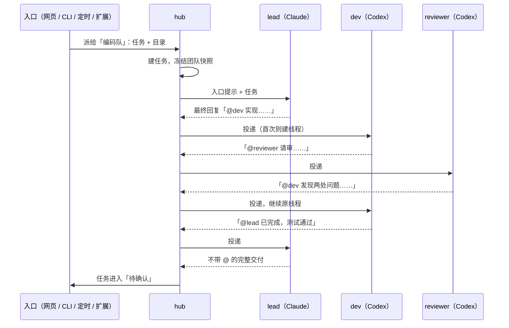

# Agent Team 设计

状态：P0 已实现，等待 review；未部署。更新：2026-10-18。

用户自己组建可复用的 agent 团队，之后从任何入口把一件事派给团队：谁牵头、谁执行、谁审查由团队定义决定，不必每次重新组队、重新交代分工。建立在现有[协作](agent-coordination-design.md)之上，执行引擎、邮箱、成员线程和智能体面板都复用。

## 和现有协作的区别

现有协作里，团队挂在一个主线程上（`coordination` 表以线程 ID 为主键），成员由主控临时 `limi spawn`，分工写在派活消息里，用完即止。它更像「一次协作」，不是「一个团队」。

| | 现有协作 | Agent Team |
|---|---|---|
| 团队从哪来 | 在线程里启用，临时招募 | 预先定义，可以有很多个，反复使用 |
| 分工 | 主控每次在提示词里说明 | 每个成员有固定说明，谁能找谁由关系图决定 |
| 成员间通信 | `limi spawn / send` 命令 | 在本轮最终回复里 `@成员名` |
| 什么时候算完 | 主控说完了 | hub 按规则判定，再由用户确认 |
| 从哪派活 | 网页里的一个线程 | 网页、命令行、定时任务、扩展、HTTP，都走同一个入口 |

两者并存。自由协作适合临时拉人；有固定流程的工作用团队。

## 参考实现

某个已上线的 agent 交付平台实现了同类功能，本设计采用它已验证的四个做法：

1. **定义和执行分开。** 团队是可复用配置；每次派活创建一个任务，创建时把团队配置冻结成快照，之后改团队不影响进行中的任务。
2. **分工就是关系图。** 一个入口成员加若干成员，成员之间是有向关系：`delegate`（派出去，要交回）和 `transfer`（转交，不交回）。牵头、执行、审查不是写死的角色，而是图上的连线。
3. **用 @ 通信，不用命令。** 成员在本轮最终回复里写 `@名字 任务`，平台解析后按关系图检查并投递。agent 不需要命令行、环境变量或 socket，所有 agent 都能用。
4. **团队是一种收件人。** 能找 agent 的入口都能找团队，团队不另设接入路径。

不照搬的部分：参考实现的工作区、Room 和内置 IM 机器人。Limi 不需要这些；IM 接入走扩展。

## 核心决定

- **成员定义内联在团队里。** Limi 只有「实例」（Codex、Claude 等账号），没有带说明的 agent 实体。不新增 agent 实体，成员的实例、模型、思考强度、目录和说明直接写在团队定义里。
- **团队任务复用协作引擎。** 一次团队任务就是一条带团队快照的 `coordination` 记录：入口成员的线程是主线程，其他成员按需建线程，邮箱、排队、并发、停止和重启恢复全部沿用。
- **@ 路由只用于团队任务。** 团队任务的成员不注入 `limi` 命令环境，不需要重启空闲进程。自由协作保持原样。
- **agent 说完成不算完成。** 判定完成后进入「待确认」，用户确认后才结束。与[目标设计](goal-design.md)一致。
- **团队存在本机。** 用户想建多少个都行，存在 SQLite，可以导出、导入分享给别人。
- **本期不涉及权限。** 成员按现有协作的方式运行，不新增权限设置。

## 团队定义

```yaml
name: 编码队
description: 写代码、交叉审查、牵头验收
entry: lead
members:
  - name: lead
    agent: claude            # 实例 ID，见 limi agents
    instruction: 拆任务、写验收标准、最终验收并向用户汇报；不亲自写代码
  - name: dev
    agent: codex
    effort: high
    instruction: 按 lead 给的契约实现并跑测试，完成后先找 reviewer
  - name: reviewer
    agent: codex
    model: <另一个模型>
    instruction: 只审查不修改，对照验收标准找正确性问题，结论交回 dev
relations:
  - { kind: delegate, from: [lead], to: dev }
  - { kind: delegate, from: [dev], to: reviewer }
budget:
  maxDeliveries: 30          # 一次任务最多投递多少条消息，超出即停下等用户
```

这张图的含义：lead 只能找 dev；dev 只能找 reviewer；reviewer 做完只能交回 dev；dev 做完交回 lead；只有入口成员能向用户交付。拓扑限制可以派给谁，并允许向未交回的上游交回；是否必须先经过审查仍需成员说明约束，P0 不把每条下游关系作为必经步骤。

校验规则：成员名在团队内唯一，`user` 保留，`lead` 可作为普通成员名；保存时不要求实例在线；关系两端都是成员；入口成员必须存在。实例后来不可用时团队仍可查看，派活时报出哪个成员不可用。

**目录。** 成员默认在任务的工作目录里工作。成员可以指定固定目录（例如文档成员固定在文档仓库），必须在 daemon 允许的范围内。以后可加「每个写代码的成员一个 worktree」选项。

## 一次任务怎么跑



**提示词。** hub 在每次投递时附加一小段团队说明，界面隐藏，与现有 `<limi-coordination>` 做法相同。内容只有：你在团队里的说明；你能 @ 的成员名单（名字逐字照抄）；做完先 @ 交回给派活给你的人；同时派给多人时等全部交回再汇总；只有入口成员可以不带 @ 直接交付。

**解析 @。** 一轮正常结束后，hub 取本轮的最终回复（沿用 `turnAnswer`），按行首的 `@名字` 拆成若干段，每段投递给对应成员。规则：

- 只能 @ 关系图上自己能直接找到的成员，或者 @ 交回给派活给自己的人。不在名单上的 @ 当作普通文字，并在成员线程里提示一次。
- 被 @ 的成员没有线程就新建；已有就续上原线程。
- 同一轮 @ 多人就并行投递，受现有「最多 3 个同时运行」限制。

**完成判定。** 每次有成员一轮结束时检查：入口成员最近一轮正常结束，回复里没有 @，没有还没交回的 delegate，也没有排队或运行中的投递，任务就进入「待确认」，入口成员这条回复就是交付结果。

- 成员做完但忘了 @ 交回：hub 用固定的去重键提醒它一次，带上它上一轮的结论。仍不交回则任务停下等用户。
- 任一成员一轮出错，或投递数超出预算：任务进入「需要处理」，不自动重试。用户可以在主线程补充要求后继续，也可以停止。
- 用户在主线程确认：任务结束。用户直接回复：视为补充要求，交给入口成员继续同一个任务。
- 任务结束后再在主线程发消息，按同一团队新建一个任务，沿用原线程的上下文。

状态：`running → awaiting_confirm → done`，旁支 `needs_attention`、`stopped`。重启后沿用协作的恢复逻辑：运行中的成员轮次标记为中断，任务进入 `needs_attention`。

## 派活入口

所有入口调用同一个服务方法 `teams.dispatch({ teamId, task, cwd, attachments, source })`，返回任务 ID 和主线程 ID。新入口只做转发。

| 入口 | 形式 | 阶段 |
|---|---|---|
| 网页：新对话 | 选 agent 的选择器里多一组「团队」，选了团队后发送即派活 | P0 |
| HTTP | `POST /api/teams/:id/tasks`，用现有 Hub token | P0 |
| 命令行 | `limi team ls`、`limi team run 编码队 --cwd DIR --task-file FILE`，走 HTTP，需要 Hub token | P0 |
| 定时任务 | 目标可以选团队，`mode: new` 每次新任务 | P1 |
| 扩展 | 扩展可以派活给团队，结果通过任务完成事件取回 | P1 |
| IM（飞书、企微等） | 由扩展接入：收到消息就派活，任务进入待确认或出错时把结果回到原会话 | P2 |
| 其他 agent | 提供 MCP 工具 `dispatch_to_team`，让 agent 在自己的会话里把活转给团队 | P2 |

`source` 记录入口和回传地址，任务状态变化时发出统一事件，各入口按需订阅，不在团队逻辑里按入口分支。

## 界面

- **配置 → 团队。** 团队列表；编辑页分两块：成员列表（实例、模型、强度、目录、说明）和「可以找谁」。每个成员一个多选框，选完下方画出只读关系图预览。先不做可拖拽画布，等成员多到列表不好用再做。
- **内置一份模板。** 「编码队」即上面的例子，用户在模板上改。
- **导入导出。** 团队可以导出为 YAML，也可以粘贴 YAML 导入；导入时按上面的规则校验，并把不可用的实例标出来。
- **任务视图。** 主线程标题旁显示团队名和任务状态；智能体面板沿用现有成员列表和消息页签，成员行显示角色名；「待确认」时在输入框上方放「确认完成」按钮，与正常回复并列。
- 界面文字进 `i18n/locales`，桌面和手机、亮色和深色都要在真实浏览器里看过。

## 数据

- 新表 `teams (id TEXT PRIMARY KEY, data TEXT NOT NULL)`，`data` 是团队定义 JSON，做法同 `coordination` 表。
- 任务不新开表：`coordination` 记录里加 `team: { teamId, snapshot, status, source, entry, resultTurnId, nudged[] }`。`Team` 类型的 `members` 增加 `role`（快照里的成员名）。
- 删除团队不影响已有任务，任务用自己的快照，仍能查看。

## 实现落点

| 文件 | 改动 |
|---|---|
| `daemon/src/teams.ts`（新） | 团队定义的校验、增删改查、导入导出、`dispatch` |
| `daemon/src/coordination.ts` | 团队任务：快照、@ 解析与拓扑检查、团队提示词、完成判定、提醒、状态 |
| `daemon/src/store.ts` | `teams` 表 |
| `daemon/src/http.ts` | 团队与任务 API |
| `daemon/bin/limi` | `team` 子命令 |
| `daemon/src/scheduler.ts` | 目标为团队（P1） |
| `web/src/components/` | 团队配置页、选择器分组、任务状态与确认 |

## P0 实现决定

上文是完整方向，P0 按下面收窄，和上文冲突时以这里为准。

- **关系只做 `delegate`。** `transfer` 留到以后；校验时拒绝其他种类。
- **漏写 @ 时自动交回，不做提醒。** 非入口成员一轮正常结束，回复里没有合法的 @，就把整段回复交回给最近一个派活给它、还没收到交回的成员（找不到时交给入口成员）。行为和现有协作「结果回给发送者」一致，所以 P0 不需要「提醒一次」。
- **合法的 @。** 只认行首的 `@名字`，名字后接空格、冒号或换行；从这一行到下一个合法 @ 行之前是给这个成员的内容。第一个合法 @ 之前的文字附在每一段前面作为背景。可以 @ 的对象：关系图里自己的下游，以及当前派活给自己、还没交回的上游。其他 @ 都当普通文字。
- **未交回的委派。** A 派给 B 时记一条未交回委派；B 之后任何一次投递给 A（显式 @A 或自动交回）关闭 A→B 最早的一条。入口成员一轮结束、没有合法 @、也没有未交回委派、没有排队或运行中的投递时，进入 `awaiting_confirm`。有未交回委派时就等着，不改状态。
- **预算 P0 就做。** 一次任务的团队投递数超过 `budget.maxDeliveries`（默认 30）就进入 `needs_attention`，不再投递。
- **出错。** 任一成员一轮出错或被中断，任务进入 `needs_attention`，协作暂停（沿用 `paused`）。用户在主线程发消息就继续，状态回到 `running`。从 `needs_attention` 继续时重置投递计数，给同一任务一份新预算；单纯停止后的继续不重置预算。继续时关闭接收方已无排队或运行中投递、且线程未在运行或排队的未交回委派，将停止/失败原因和未送达的结果摘要记成一次性通知，附在入口成员下一轮的团队提示里，供它决定是否重新 @。
- **确认和后续消息。** `awaiting_confirm` 时用户点「确认完成」进入 `done`；用户直接回复则是补充要求，回到 `running`，同一个任务。`done` 之后再发消息，开始同一主线程上的新任务：按团队当前定义重新拍快照（团队已删除就沿用旧快照），清空委派和预算计数，成员按名字续用原线程，实例变了就新建线程。保留之前的投递记录，供消息页查看历史。未暂停的 `awaiting_confirm` 调用 resume 不改变状态和交付轮次。
- **导入导出用 JSON。** 项目里没有 YAML 依赖，P0 不新增依赖。
- **模板。** 「编码队」模板由 daemon 生成草稿，三个成员默认都填第一个可用且支持协作的实例，用户在编辑页里改。不按 agent 名字挑实例。

## P0 落地边界与接口

- 团队模式按快照里的 `entry` 识别入口，`lead` 只是合法名字；自由协作的 `lead` 主控保留语义不变，团队任务拒绝 `limi spawn/send`。
- `GET /api/teams` 返回列表概况（包括 `memberCount`），编辑时用 `GET /api/teams/:id` 读取完整定义。模型与强度选项只在打开选择器时读取；任务概况不传成员的长说明。模板和导入导出都使用 JSON。
- 服务入口为 `dispatch({ teamId, text, cwd, source })`，返回 `{ taskId, threadId }`。HTTP 默认来源 `http`，网页为 `web`，CLI 为 `cli`。主线程始终在派活给出的 `cwd` 创建，其他成员的固定目录优先于任务目录。
- 新任务按成员名字续用上下文；实例或固定目录改变时另建成员线程，旧线程仍与主线程关联，历史事件保留。只有设置实际变化才更新已有成员的模型和强度。
- **入口实例变更的限制：** 已完成的主线程继续接任务时，如果当前定义更换了入口实例，返回 409，提示从新对话派发。原生会话不能跨实例恢复，P0 没有把另一个实例的会话塞进同一个线程。入口实例不变时正常重拍快照、重置委派与预算，并保留历史任务简表。
- **预算耗尽后：** 用户补充要求或显式 resume 会恢复运行状态，并把当前任务的投递计数归零。任务 ID、快照和已保存的投递记录保留；暂停期间不自动重试失败的工作。
- 重启时重放已经落盘但尚未入邮箱的结束事件；真正被中断的任务进入 `needs_attention` 并暂停，不把失败伪装成正常交回。同一次恢复中的正常结果仍保存在投递记录里，继续时将未送达结果带给入口成员。关闭委派的通知持久化，每条结果摘要最多 1000 字符，在入口新一轮的 `turn.started` 与提示一起落盘时消费；预览、排队和启动前拒绝不会消费。普通自由协作仍沿用原先的恢复规则。
- 环境只使用当前线程显式提供的协作凭据，不继承启动 daemon 的其他 agent 的 `LIMI_SOCKET/LIMI_KEY/LIMI_BIN_DIR`。团队线程不注入这些变量；该规则在适配器公共环境函数实现。

## 分阶段

- **P0：能派、能跑、能确认。** 团队定义与配置页、内置模板、网页 / HTTP / CLI 入口、@ 路由与拓扑检查、完成判定、待确认、快照、重启恢复。
- **P1：更省心。** `transfer` 关系、定时任务入口、扩展入口、任务事件、成员 worktree 选项。
- **P2：更多入口与编辑方式。** IM 扩展、MCP 派活工具、可拖拽画布、项目级团队（跟仓库走的团队定义）。

## 验证

- 单元测试：团队校验；@ 解析（多人、越权、交回、行内 @ 不算）；完成判定的每条规则；预算；自动交回；快照不随团队修改变化；重启恢复。
- 假 agent：在 `test/fixtures/` 里按脚本输出 @ 回复，跑通「lead → dev → reviewer → dev → lead → 待确认」以及审查返工两轮的完整流程。
- 浏览器：配置页、新对话选团队、任务状态与确认，桌面和手机，亮色和深色。
- 真实联调：Claude 牵头、两个 Codex 执行与审查，跑一个小改动，记录投递次数与用时。

## 暂不做

权限与多人共用、跨机器成员、成员之间共享记忆、自动合并分支、角色市场。
