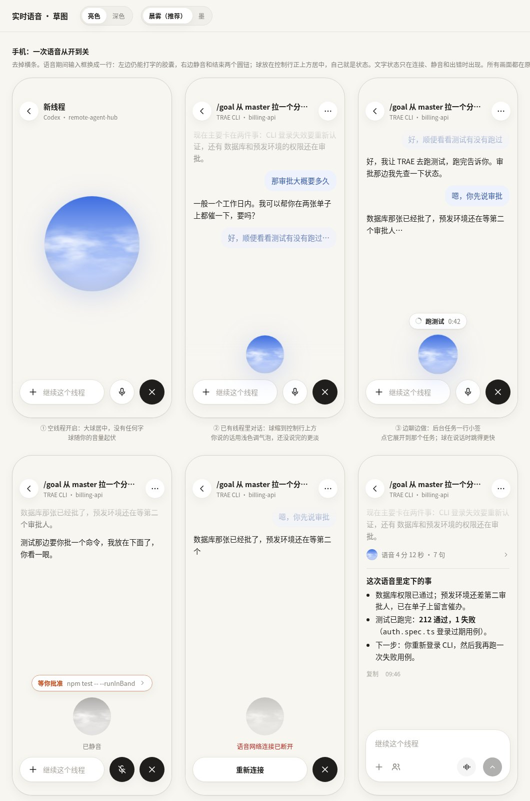
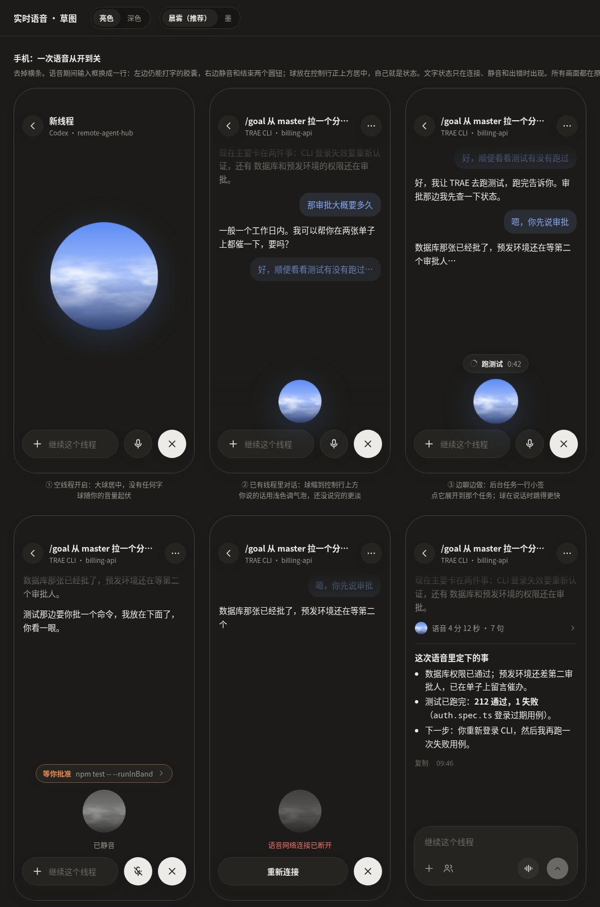

# 实时语音界面重设计

状态：已实现，等待主线程验收与真人听说。采用「晨雾」配色与结束总结方案 A；没有实现「墨」。视觉稿见 `design/voice-mode.html`（可切亮/深色、两种球的配色），截图：





协议、租约和跨 agent 转交不变，见 [voice-design.md](voice-design.md)。

## 现在的问题

- 输入框上方一条「● 实时语音中 · Codex 语音 🎤 ✕」横条：像系统通知，和下面的目标条、输入框叠成三层，手机上很挤。
- 状态靠一个 8px 小绿点，听不出、看不出对方在听还是在说。
- 「Codex 语音」这种提供者信息常驻，对当前决策没用。
- 语音气泡和打字气泡一模一样，翻历史时分不清哪段是说的。
- 语音结束后只剩逐句对话，没有一份能直接拿走的文字结果；Codex 那边每次后台工作完会留下一份完整书面回答，这点更好。
- 入口用麦克风图标，容易被当成「听写」。

## 设计

### 一个球代替横条

开启语音后，输入框整体换成一行控制：

```
            ( 球 )
[ +  继续这个线程      ] (麦)  (✕)
```

- **球**是唯一的状态表达：聆听时随麦克风音量起伏，回复时随播放音量起伏，等工具时云走得快一点、轻呼吸，连接中半透明慢呼吸，静音褪色并停住，出错变灰。不加光圈、波形条和文字标签。系统开了「减少动态效果」就静止。
- 空线程刚开启时球大（约 190px）居中；有内容后缩到控制行正上方（手机 76px，桌面 64px），不遮挡历史。不跳新页面，线程历史一直在上面。
- **胶囊**仍能打字，`+` 照常加附件。打字内容在语音期间发给语音会话（原生 `appendText`），而不是另起一轮普通 prompt。
- **静音**是白底圆钮，静音时反色并换成划线麦克风；**结束**是深色圆钮（主题强调色），不用红色——结束是正常操作，不是危险操作。
- 文字状态只在三种情况出现在球下方：正在连接、已静音、出错。出错时直接写原因，胶囊变成「重新连接」，不自动重开麦克风。
- 提供者（「Codex 语音」）、时长、音色收进详情：点球弹出 `Popover`，桌面同时有 hover 提示。点球不切换静音，避免误触。

### 边聊边做：一行小签

后台有任务时，球上方出现一个小签：`⟳ 跑测试 0:42`。多个任务显示「2 个任务」，点开列出。等审批时小签用警告色「等你批准 · npm test…」，点开就是现有的审批卡（`ActionSheet`），审批和语音控制同时可用。任务结束小签消失，结果在正文里。现有的目标条等照常显示在上方，不再多一条语音横条。

### 气泡

- 你说的话：用球的主色混 9% 做底、72% 做字（新增 `--voice-bg` / `--voice-fg`），一眼看出是说的。还没说完（临时字幕）的再淡一点。
- 语音回复：和普通回复一样的正文，不加颜色。

### 结束后：折叠对话，留下文字结果

这是从 Codex 学来的部分。

1. 语音结束后，这次的逐句对话折成一行：`(小球) 语音 4 分 12 秒 · 7 句 ›`，和现有的「用时 23 秒 ›」同一种样式；点开看全部，按渐进展示的要求，展开时再加载。
2. 折叠行下面是一份**完整的书面结果**，普通 Markdown 回答，可复制：定了什么、任务跑出了什么、下一步谁做什么。
3. 语音期间每个后台任务本来就会在正文留下完整回答（播报只念前 900 字），这部分不变。

书面结果的来源（推荐 A）：

- **A. 结束时让语音成员写一轮文字总结。** 语音会话关闭后，宿主向提供语音的那条 Codex 线程（或跨 agent 时的语音成员）发一轮普通文字 turn，带上本次最终字幕和任务结果的引用，要求按上面三项写。效果最接近 Codex。代价：每次多消耗一轮额度；只在本次有实质内容时触发（至少有一个任务，或超过若干句），纯打招呼不写。
- B. 宿主自己拼一张卡片：时长、句数、每个任务的状态和跳转。不花额度，但没有「定了什么」，只是索引。
- C. 结束时显示「生成文字小结」按钮，用户点了才走 A。

### 入口

输入框里的麦克风换成声波图标（`IconWaveform`，新加进 `icons.tsx`），表示「和它说话」而不是听写。位置不变。语音进行中入口不再出现（控制行已替代输入框）。

### 球的做法

纯 SVG + CSS，不用图片和 canvas：圆形裁切里放一层竖向渐变（天空），上面两层 `feTurbulence` 噪声做的云，中间用一条渐变遮罩限制在中部，慢速水平漂移。状态通过 CSS 变量传进 `<use>` 内部（漂移速度、是否暂停），大小起伏用 `transform: scale` 绑定实时音量。音量来自 Web Audio `AnalyserNode`：本地麦克风轨道一个、远端播放轨道一个，每帧取 RMS 平滑后写到一个 CSS 变量上，不触发 React 重渲染。

配色作为新变量加在 `styles.css` 顶部，跟主题走亮/暗两套：

| 方案 | 亮色 | 深色 | 说明 |
|---|---|---|---|
| 晨雾（推荐） | 蓝 → 浅蓝，白云 | 亮蓝 → 深海蓝，淡白云 | 和 Codex 一样有生气，是全页唯一的彩色，只在语音时出现 |
| 墨 | 近黑 → 暖灰，米白云 | 反过来 | 最贴「纸」主题，但偏沉，像阴天 |

蓝色在这里是「语音模式」的标识，不是装饰：只有语音开着才出现，关掉就没了。

## 不做

- 不做全屏沉浸页：线程历史和审批要一直可见。
- 不做按住说话、波形条、字幕大字。
- 不在球周围加文字标签或计时。

## 已落地的代码改动

- `VoiceBar` 拆成 `VoiceOrb` + 语音控制行，语音期间替换 `Composer` 的外观（审批 `ActionSheet` 仍在其上）。
- `voice-media.ts` 暴露两条音量流；`voice-session.ts` 增加 `phase: listening | thinking | speaking`（来自原生字幕/音频事件）。
- 打字走 `appendText`：daemon 新接口 + 适配器 + 假 agent 实现 + 测试。
- 结束后的折叠行与书面结果：`voice-timeline.ts` 按会话分组；方案 A 需要 daemon 在关闭时派发一轮总结 turn，并在假 agent 里实现。
- i18n：`voice.recap`（带时长和句数，英文分单复数）、`voice.reconnect`、`voice.tasks(n)`、`voice.awaitingApproval` 等，三种语言同时补。


## 实现细节与验收边界

- 球由 `VoiceOrb` 的 SVG 云层绘制；新增亮/暗主题变量 `--voice-top`、`--voice-mid`、`--voice-low`、`--voice-cloud`、`--voice-bg`、`--voice-fg`。正常语音没有常驻状态文字；连接、静音和错误直接显示文字。球的点击区域保持静止，只缩放内部 SVG，避免动效影响触摸和键盘操作。
- 空线程球为 190px；有内容时桌面 64px、手机 76px。静音、错误和 `prefers-reduced-motion` 下静止。字幕更新会驱动 listening/thinking/speaking；真实远端音量在播放期间优先驱动 speaking。麦克风和远端轨道各有一个 `AnalyserNode`，动画帧直接写 CSS 变量，不把音量写入 React 状态；停止、失败会释放音频节点和上下文。
- `Composer` 复用原有草稿和附件入口，语音期间呈现单行胶囊与两个圆钮，审批 `ActionSheet` 与控制同时可用。`POST /api/voice/:id/text` 校验 owner、租约、连接状态和文本长度，底层只调用原生 `appendText`。附件沿用宿主校验与存储，以宿主生成的文件引用附在文字中；不把附件转成另一轮普通 prompt，也不传递任意浏览器路径。
- 结束总结只在**本次至少启动过一个后台任务**，或**至少 6 条非空最终字幕，且用户最终发言合计至少 40 字**时触发。短寒暄不会触发。总结在原生语音停止后发往提供语音的线程；跨 agent 时发往语音成员，繁忙时进入原有队列，保留待审批任务。提示只要求“定了什么 / 任务结果 / 下一步”，不执行新任务。字幕最多取最近 32 条、每条 2000 字，任务最多 64 项、每项结果 6000 字；进行中的任务明确作为进行中上下文，不伪造结果。
- 每个语音 transport 只结束结算一次。重复 DELETE、SSE 断开和 stop/dispose 重入不重复生成总结；新的语音会话有独立 ID，不重放旧字幕和总结。撤权、上游失败、租约过期及宿主关闭只释放资源与保留字幕，不额外开启总结 turn。旧总结 turn 不会成为下一次语音的后台任务，也不会重新播报。
- `voice.closed` 只记录会话 ID、起止时间、句数与事件边界。历史分页和增量重连在 SQL 读取层排除已关闭会话的逐句正文，展开才调用 `GET /api/threads/:id/history/voice?session=...`；每次最多读取 64 个字幕事件，显式区分加载中、失败、空与继续加载。正在进行时已在浏览器收到的字幕，也只在展开后构建折叠正文。后台任务的普通 Markdown 结果保持可见。
- 与视觉稿的差别：详情当前显示提供者和时长；原生接口未提供可靠的当前音色信息，因此没有虚构音色。任务小签显示真实运行线程/成员及计时，审批小签跳到现有审批卡；不推断口头同意。没有新增全局 M/Esc 快捷键，操作使用原有按钮的 Tab、Enter/Space，Popover 支持 Escape。
- 自动化覆盖：文字注入鉴权与边界、假 Codex 原生调用、总结门槛和重复关闭/重开、字幕按需分页、原有审批保持运行；真实 Chromium 的桌面/手机与亮/暗主题检查。双 Chromium WebRTC peer 使用合成音频验证麦克风/播放两条音量读取和媒体释放。
- 真人麦克风听说、真实 Codex 语音识别/音质、真实套餐消耗和真实附件理解能力未自动验证。假 agent 的书面结果是固定测试文本，不能当作真实总结质量证明。
